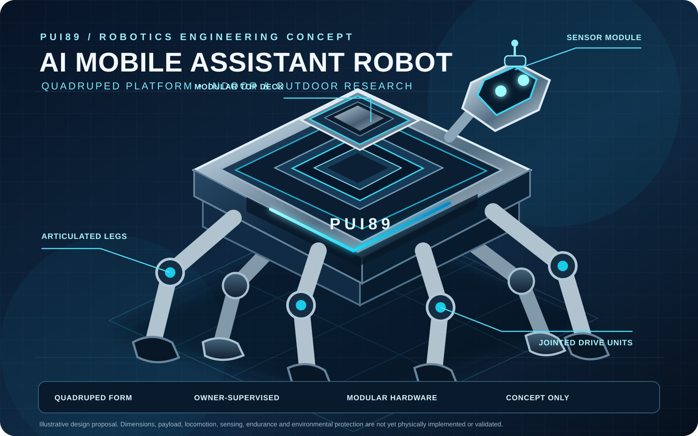

# PUI89 AI Mobile Assistant Robot

<!-- PUI89_PINNED_CONCEPT_ILLUSTRATION:START -->

*Conceptual design illustration — not a built or validated robot. Dimensions, weight, mobility, endurance, weather resistance and field performance remain design targets pending engineering and physical validation.*
<!-- PUI89_PINNED_CONCEPT_ILLUSTRATION:END -->

## Open-source-first engineering

PUI89 prioritises open-source software, transparent licensing, reproducible workflows and evidence-led collaboration. Model weights, datasets, hosted services and hardware are assessed separately for provenance, licence terms, security, data handling, resource requirements and intended use. Public availability alone does not establish permission for reuse or commercial deployment.

> **PUI89 engineering standard:** [Simple, Safe and Professional](https://github.com/Pui89/Pui89.github.io/blob/main/docs/PUI89_SIMPLE_SAFE_PROFESSIONAL_STANDARD.md) — shared guidance for usability, safety, evidence, privacy and maintainable engineering.

> **PUI89 | Intelligent Systems. Verifiable Decisions. Safer Outcomes.**
> 
> **Project:** PUI89 AI Mobile Assistant Robot  
> **Focus:** Owner-supervised quadruped mobile assistant robot concept  
> **Development stage:** Early software foundation and design targets; locomotion, endurance and field performance are not validated.
> 
> **Project website:** [English](https://pui89.github.io/nomad.html) · [ภาษาไทย](https://pui89.github.io/nomad-th.html) · [PUI89 portfolio](https://pui89.github.io/)
> 
> **Validation boundary:** Proposed dimensions and weight are design targets, not measured prototype specifications; AI Mobile Assistant Robot is not an emergency responder or unsupervised roaming system.

## Commercial readiness progress

**30% — evidence-based commercial-readiness estimate**  
**Target: 100% = ready for an appropriately scoped commercial release or formal commercial procurement submission.** This is not a code-completion percentage, a sales forecast, or a claim of product certification. Scores are provisional and based on the evidence currently documented in this repository; they must be revised when new evidence is verified.

The repository contains concept requirements, architecture, early deterministic software foundation and automated tests. No built robot, validated locomotion, real sensor integration, endurance, weather protection or field performance is established.

| Readiness gate | Weight | Evidence credit |
|---|---:|---:|
| Product purpose & requirements | 10 | 8 |
| Architecture & engineering design | 10 | 8 |
| Working software baseline | 15 | 5 |
| Reproducible tests & evaluation | 15 | 4 |
| Integrated product prototype | 15 | 0 |
| Safety, reliability & real-world validation | 15 | 1 |
| Licensing, IP & regulatory readiness | 10 | 3 |
| Commercial release package & support | 10 | 1 |
| **Total** | **100** | **30** |

**What 100% requires:** a defined product and acceptance criteria; integrated release candidate; reproducible performance and reliability evidence; appropriate safety and real-world validation; verified rights/licences and applicable regulatory conformity; manufacturing/deployment, pricing, warranty, maintenance, user documentation and support arrangements. A score of 100% is awarded only after all applicable release gates are evidenced and reviewed. Partner or research discussions may happen earlier, but must be labelled as development-stage collaboration—not a ready-to-sell product.

**Next commercial-readiness gate:** close the missing evidence above, beginning with project-specific working-product validation and safety evidence. Never count a planned feature, concept image, tool inventory, synthetic-only result or unrun test as a completed gate.

_Last readiness review: 7 November 2026. This estimate can rise or fall as evidence changes._

## Project website QR codes

<table><tr><td align="center"><strong>English website</strong>  <a href="https://pui89.github.io/nomad.html">Open English website</a></td><td align="center"><strong>เว็บไซต์ภาษาไทย</strong>  <a href="https://pui89.github.io/nomad-th.html">เปิดเว็บไซต์ภาษาไทย</a></td></tr></table>
### A Portable Quadruped Assistant for Home, Travel and Everyday Life

**A mobile companion designed to help people indoors and outdoors.**

PUI89 AI Mobile Assistant Robot is an early-stage mobile assistant robot concept with a quadruped, robot-dog form. It is intended to support people in everyday environments, including carrying belongings, supervised accompaniment, travel and outdoor awareness. These are design goals, not validated capabilities.

- **Repository:** https://github.com/Pui89/AI-Mobile-Assistant-Robot
- **Website:** [English](https://pui89.github.io/nomad.html) · [ภาษาไทย](https://pui89.github.io/nomad-th.html)
- **Separate indoor home-safety product:** [PUI89 AI HOME](https://github.com/Pui89/AI-HOME) · [English website](https://pui89.github.io/home.html) · [ภาษาไทย](https://pui89.github.io/home-th.html)

> **Product boundary:** AI Mobile Assistant Robot is a mobile assistant concept for indoor and outdoor everyday use, travel and carrying assistance. HOME is a separate four-wheel indoor home-safety robot. The products may share versioned PUI89 AI Core contracts, but they are not one robot and do not share physical operating assumptions.

## AI Mobile Assistant Robot purpose

AI Mobile Assistant Robot is intended as an owner-supervised mobile companion. Proposed research areas include:
- Carrying shopping, luggage and personal belongings within a validated payload limit
- Owner-supervised accompaniment in suitable indoor and outdoor environments
- Travel, walking, park, station and campsite assistance concepts
- Indoor/outdoor scene and obstacle awareness
- Mapping and localization research, with safe-stop behaviour when uncertain
- Environmental observations when suitable sensors are selected and validated
- Offline-first operation and clear owner-facing reports

AI Mobile Assistant Robot is not an emergency responder or an unsupervised roaming machine. It must not enter hazardous areas merely to investigate. Carrying capacity, following behaviour, accessibility support and safe operation remain unvalidated design goals.

## Proposed physical design targets

| Parameter | Proposed target |
|---|---:|
| Form | Four-legged quadruped robot dog |
| Height | 50–60 cm |
| Width | 30–36 cm |
| Depth | 20–25 cm |
| Complete weight target | 8 kg |
| Absolute maximum complete weight | 10 kg |
| Battery | Removable-battery concept |
| Structure | Lightweight protective shell; guarded joints and wiring |
| Environment | Indoor and outdoor use, only within separately validated operating limits |

Weight includes battery, sensors, computer, enclosure and accessories. Dimensions and weight are design goals, not measured prototype specifications. Terrain, gait, endurance, weather limits, payload and indoor floor compatibility remain unvalidated.

## Proposed operating workflow

Observe → check evidence quality → understand location and context → assess uncertainty and risk → choose a safe movement state → report to the owner.

The owner remains responsible for decisions. If localization, route safety or battery reserve is insufficient, the robot should stop safely rather than attempt an unsafe return or continue moving.

## Safety and resilience requirements

- Define and test separate limits for indoor floors, thresholds, stairs, people, pets, rain, dust, temperature, slopes, loose ground, water exposure, darkness, battery endurance and connectivity.
- Prioritize battery protection, electrical isolation, overcurrent protection, thermal monitoring and guarded wiring.
- Treat weather resistance, water resistance and fire performance as engineering requirements requiring specified tests; do not claim waterproof or fireproof performance.
- Never delay emergency response or substitute for certified alarms and qualified responders.
- Use human supervision, safe-stop defaults and clear uncertainty reporting.
- Protect location data and avoid unnecessary recording of people.

## Shared intelligence, separate product engineering

AI Mobile Assistant Robot may reuse PUI89 AI Core contracts (WorldState, Observation, ActionProposal and FailureReport), evidence provenance, uncertainty handling, safety gates, benchmark records and report formats. Its quadruped locomotion, indoor/outdoor navigation, sensor layout, environmental protection and risk assessment remain AI Mobile Assistant Robot-specific.

## Current development status

**FOUNDATION / SIMULATION-ONLY / CONCEPT.** The repository contains an early deterministic software foundation, documentation and automated tests. It does not establish a built robot, real sensor integration, trained AI model, validated locomotion, indoor/outdoor reliability, certified safety or real-world hazard-detection performance.

## local-first and supply-chain policy

External services and model downloads require prior origin, licensing, security and resource review. PUI89 excludes Chinese-origin AI models, providers and model-hosting services from its approved stack.

## Evidence labels

PROPOSED = planned; IMPLEMENTED = code exists; TESTED = automated test passed; SIMULATION-ONLY = synthetic inputs only; MEASURED = quantitative result with method; VERIFIED = reproducibly checked; NOT_VALIDATED = real-world performance not established.

See [Architecture](docs/ARCHITECTURE.md), [Safety Case](docs/SAFETY_CASE.md), [Intelligence Catalogue](docs/INTELLIGENCE_CATALOGUE.md), [Supply-chain Policy](docs/MODEL_AND_SUPPLY_CHAIN_POLICY.md), [Roadmap](docs/ROADMAP.md), [Water Resilience Standard](docs/PUI89_WATER_RESILIENCE_STANDARD.md) and [Resilience Standard](docs/PUI89_RESILIENCE_STANDARD.md).

**PUI89 — Intelligent Systems. Verifiable Decisions. Safer Outcomes.**

## Hugging Face vision models — opt-in local integration

This repository now includes real Hugging Face checkpoint adapters in [`pui89_models/hf_vision.py`](pui89_models/hf_vision.py), with project-specific usage boundaries in [`docs/HUGGING_FACE_MODEL_INTEGRATION.md`](docs/HUGGING_FACE_MODEL_INTEGRATION.md).

- **OWLv2:** `google/owlv2-base-patch16-ensemble` for text-conditioned object proposals.
- **Intel DPT-Hybrid:** `Intel/dpt-hybrid-midas` for relative scene depth where appropriate; not calibrated distance or physical depth.
- **local-first default:** no packages or model weights are installed/downloaded automatically; CPU-only inference, local cache only by default, no hosted inference API or cloud GPU.
- **Evidence status:** adapter code is added; model inference and project-specific accuracy are NOT YET TESTED. Outputs remain uncertain observations for human review, never actuator commands.

<!-- PUI89_DAILY_PROGRESS:START -->
## Daily project progress

**🟠 30% — Foundation and prototype stage**  
**Evidence score:** 30/100 · **Review date:** 7 November 2026 (Asia/Bangkok)  
**Progress graph:** 🟦🟦🟦🟦🟦🟦⬜⬜⬜⬜⬜⬜⬜⬜⬜⬜⬜⬜⬜⬜ 30%

This is an evidence-weighted commercial-readiness estimate, not a code-completion percentage, sales forecast, certification, or measured real-world performance. Scores change only when repository evidence is reviewed and the evidence credits below are updated. The daily run refreshes the review date; it never increases the score merely because time has passed.

| Readiness gate | Evidence credit | Visual score |
|---|---:|---|
| Purpose & requirements | 8/10 | 🟩🟩🟩🟩🟩🟩🟩🟩⬜⬜ |
| Architecture & engineering | 8/10 | 🟩🟩🟩🟩🟩🟩🟩🟩⬜⬜ |
| Working software baseline | 5/15 | 🟩🟩🟩🟩🟩⬜⬜⬜⬜⬜⬜⬜⬜⬜⬜ |
| Reproducible tests & evaluation | 4/15 | 🟩🟩🟩🟩⬜⬜⬜⬜⬜⬜⬜⬜⬜⬜⬜ |
| Integrated product prototype | 0/15 | ⬜⬜⬜⬜⬜⬜⬜⬜⬜⬜⬜⬜⬜⬜⬜ |
| Safety & real-world validation | 1/15 | 🟩⬜⬜⬜⬜⬜⬜⬜⬜⬜⬜⬜⬜⬜⬜ |
| Licensing & regulatory readiness | 3/10 | 🟩🟩🟩⬜⬜⬜⬜⬜⬜⬜ |
| Release package & support | 1/10 | 🟩⬜⬜⬜⬜⬜⬜⬜⬜⬜ |
| **Total** | **30/100** | **🟦🟦🟦🟦🟦🟦⬜⬜⬜⬜⬜⬜⬜⬜⬜⬜⬜⬜⬜⬜** |

**Next milestone:** Improve the lowest-scoring applicable gate with reproducible project-specific evidence. Planned work, concept artwork, unrun tests, synthetic-only results and tool inventories do not earn evidence credit.

**Status boundary:** Software tests and simulations do not establish a built, certified, field-tested or commercially validated physical product. Real-world claims require separate, traceable validation.

<!-- PUI89_DAILY_PROGRESS:END -->

---

## Security, malware and supply-chain protection

Security policy: [SECURITY.md](SECURITY.md). Report suspected vulnerabilities privately; do not post travel routes, precise locations, credentials or private sensor records publicly.

Project-specific controls and review requirements:
- Treat GPS, location, environmental sensors, camera/audio, maps, downloaded files and external messages as untrusted inputs.
- Validate timestamps, source provenance, ranges, replay/stale data and offline behaviour.
- Never commit credentials, private travel histories, home addresses or identifiable recordings.
- Review packages, model files, simulator plugins and GitHub Actions for provenance, licence and vulnerability risks before adoption.
- AI suggestions must not directly control mobility, locks or safety-critical hardware; require human approval and safe-stop behaviour.
- Keep CI permissions minimal and never expose secrets to untrusted pull-request code.

A scan or passing test is evidence only for the checks actually run; it does not establish whether the repository contains malware or vulnerabilities.

## PUI89 seven-dimension quality recommendations

**Last reviewed: 8 November 2026 · Review month: November 2026**

This project uses the shared PUI89 quality framework. The indicators are guidance/status labels, not scores, certification or proof that work is complete.

| Dimension | Recommendation for this project | Indicator |
|---|---|---|
| Brand identity | Maintain the PUI89 Deep Navy + Electric Cyan system, consistent project naming and the approved project accent. | 🔵 Guidance |
| Website and accessibility | Keep English and Thai pages aligned, responsive, accessible, correctly linked and date-stamped. | 🔵 Guidance |
| AI software and applications | Version contracts, preserve provenance, propagate uncertainty, abstain on insufficient evidence and test safe human-review boundaries. | 🟢 Quality target |
| Physical products and robotics | Define measurable structural, power, thermal, water-ingress, fire-risk, maintenance and emergency-stop requirements; do not claim untested ratings. | 🟠 Evidence required |
| Documentation and research evidence | Maintain architecture, requirements, reproducible tests, data/model licences, limitations and traceable evidence links. | 🔵 Guidance |
| Product and commercial readiness | Validate the user problem, intended operator, value, support model, lawful IP/data position and release gates before commercial claims. | 🟠 Evidence required |
| Professional environment and presentation | Use consistent technical diagrams, demonstrations and partner-facing materials; do not imply facilities or partnerships without evidence. | ⚪ Not assessed |

**Project-specific priority:** Keep AI Mobile Assistant Robot distinct from indoor HOME as a portable/outdoor mobile assistant. Prioritise stability, obstacle handling, battery isolation, offline behaviour, enclosure drainage/sealing strategy, serviceability and supervised operation; dimensions, weight, locomotion, endurance and weather protection remain design targets until measured.

**Status legend:** 🔵 framework guidance added · 🟢 engineering quality target · 🟠 evidence or validation still required · ⚪ not assessed. These labels describe the review state of recommendations, not overall project maturity. Project maturity changes only when supported by verified repository evidence, reproducible tests or controlled validation.

<!-- PUI89_PROJECT_STRENGTH_SCORECARD:START -->
## PUI89 Project Strength Scorecard | เกณฑ์ประเมินความแข็งแกร่งของโครงการ

**Current review status: Not yet scored · Completed evidence-backed strength reviews: 0.** This is a recordkeeping status, not a claim that no development or testing exists.

**สถานะการประเมิน: ยังไม่มีคะแนน · รายงานประเมินที่เสร็จสมบูรณ์และมีหลักฐาน: 0 รายการ** ตัวเลขนี้หมายถึงจำนวนรายงานที่บันทึกครบตามเกณฑ์ ไม่ได้หมายความว่าไม่มีการพัฒนาหรือทดสอบ

### Four Project Indicators | ตัวชี้วัดโครงการ 4 ด้าน

| Indicator / ตัวชี้วัด | What it measures / สิ่งที่ประเมิน | Current status / สถานะ |
|---|---|---|
| Engineering Strength / ความแข็งแกร่งทางวิศวกรรม | Verified technical capability and system integration / ความสามารถทางเทคนิคและการเชื่อมต่อระบบที่ตรวจสอบได้ | Not yet assessed / ยังไม่ได้ประเมิน |
| Evidence Confidence / ความเชื่อมั่นของหลักฐาน | Evidence traceability, reproducibility and validation quality / การตรวจสอบย้อนกลับ การทำซ้ำ และคุณภาพการตรวจสอบ | Not yet assessed / ยังไม่ได้ประเมิน |
| Implementation Level / ระดับการพัฒนาที่ดำเนินการแล้ว | Work actually implemented, separated from proposed work / งานที่พัฒนาแล้วจริง แยกจากงานที่เป็นข้อเสนอ | Not yet assessed / ยังไม่ได้ประเมิน |
| Project Maturity / ความสมบูรณ์ของโครงการ | Evidence-based development stage, from concept to operational demonstration / ระยะการพัฒนาที่อ้างอิงหลักฐาน ตั้งแต่แนวคิดถึงการสาธิตการใช้งานจริง | Formal stage assessment pending / รอการประเมินระดับอย่างเป็นทางการ |

These four indicators are separate from the weighted 100-point score below. No score, percentage or maturity stage is assigned until a dated evidence-backed review is completed.

ตัวชี้วัดทั้ง 4 ด้านนี้แยกจากคะแนนถ่วงน้ำหนัก 100 คะแนนด้านล่าง จะไม่กำหนดคะแนน เปอร์เซ็นต์ หรือระดับความสมบูรณ์จนกว่าจะมีรายงานประเมินที่ลงวันที่และมีหลักฐานครบถ้วน

| Dimension / ด้านประเมิน | Weight / น้ำหนัก |
|---|---:|
| Technical capability / ความสามารถทางเทคนิค | 25 |
| Testing and evidence / การทดสอบและหลักฐาน | 25 |
| Safety and reliability / ความปลอดภัยและความน่าเชื่อถือ | 20 |
| Engineering maturity / วุฒิภาวะทางวิศวกรรม | 15 |
| Documentation and reproducibility / เอกสารและการทำซ้ำผล | 10 |
| Real-world validation / การตรวจสอบในโลกจริง | 5 |
| **Total / รวม** | **100** |

Scores are awarded only through a dated review with a defined scope, version/commit, evidence links, findings, limitations and next actions. Concepts, planned features, concept images, unrun tests and tool inventories do not earn implementation or test credit. Simulation results do not prove physical-world performance.

จะให้คะแนนเมื่อมีรายงานที่ระบุวันที่ ขอบเขต เวอร์ชัน/commit ลิงก์หลักฐาน ข้อค้นพบ ข้อจำกัด และขั้นตอนถัดไปเท่านั้น แนวคิด ฟีเจอร์ที่วางแผน ภาพแนวคิด การทดสอบที่ยังไม่ได้รัน และรายการเครื่องมือ จะไม่ได้คะแนนว่าเป็นการพัฒนาหรือการทดสอบที่เสร็จแล้ว ผลจำลองไม่ใช่หลักฐานยืนยันประสิทธิภาพในโลกจริง

**Scoring method / รายละเอียดเกณฑ์:** [English](https://github.com/Pui89/Pui89.github.io/blob/main/docs/PROJECT_STRENGTH_SCORECARD.md) · [ภาษาไทย](https://github.com/Pui89/Pui89.github.io/blob/main/docs/PROJECT_STRENGTH_SCORECARD_TH.md)

This score is separate from any commercial-readiness estimate and is not certification, safety approval or an investment rating.
<!-- PUI89_PROJECT_STRENGTH_SCORECARD:END -->

## Materials & Hardware — Research Plan

**Status: AI Mobile Assistant Robot mobile-assistant concept and hardware research.** The proposed portable unit is not a validated product. Treat the luggage-style enclosure and target dimensions/weight as design goals until measured on a prototype.

| Subsystem | Candidate materials / hardware | Intended role | Required checks before selection |
|---|---|---|---|
| Outer shell | Impact-resistant polymer or aluminium shell, replaceable corner guards and weather seals | Protect internal equipment during travel | Impact, abrasion, temperature, repairability, ingress and material fire behaviour |
| Frame and handle | Aluminium alloy or steel reinforcement, telescopic pull handle and reinforced attachment points | Support lifting, pulling and transport | Static/dynamic loads, fatigue, pinch points, corrosion and handle retention |
| Mobility | Four replaceable wheels, sealed bearings and optional wheel brakes | Roll over indoor and outdoor surfaces | Load rating, stability, obstacle clearance, wear and water/mud ingress |
| Power | Removable battery pack with BMS, fuses, protected charging port and battery-status sensing | Portable power | Airline/transport rules, chemistry, capacity, thermal protection and safe charging |
| Compute | Low-power edge computer and microcontroller for sensor supervision | Local assistant functions | RAM/CPU, heat, battery runtime, update security and offline capability |
| Perception | RGB cameras, optional depth sensor, microphones and ambient light sensor | Observe surroundings and support user interaction | Privacy, field of view, low-light limits, calibration and consent |
| Navigation and location | IMU, wheel encoders, GNSS outdoors and optional proximity sensors | Estimate movement and location | Indoor GNSS limitations, drift, obstacle detection and safe stop |
| Connectivity | Wi-Fi/Bluetooth and optional cellular module only if justified | User interface and optional remote connectivity | Offline fallback, encryption, data minimisation and recurring-cost review |
| Environmental protection | Gaskets, protected connectors, drainage strategy and conformal coating where appropriate | Improve resistance to dust/moisture | Ingress tests, condensation, corrosion and repairability; no rating without test |
| User interface | Display, physical controls, speaker, status LEDs and accessible tactile controls | Communicate status and alerts | Accessibility, glare, volume, failure indications and user testing |

**Design priorities:** keep the device stable, repairable, easy to lift and pull, with protected wheels, accessible battery isolation and a clear manual shutdown. Any GPS, microphone or camera function must be transparent and privacy-preserving.

**Development boundary:** build the software assistant, offline workflows and sensor-data contracts first. Do not assume autonomous following, stair climbing, obstacle avoidance or outdoor weather operation until each has been separately engineered and tested.

**Procurement rule:** research first. No purchases, subscriptions, supplier contact or paid services without explicit approval. Verify dimensions, component weights, load ratings, transport rules, datasheets, warranty and total landed cost before selection.
