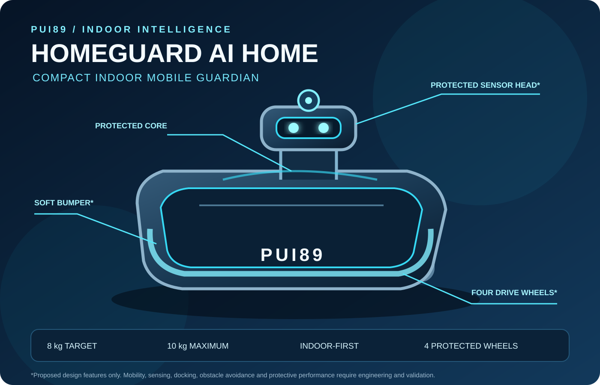

# HOMEGUARD AI NOMAD
### Two purpose-built robot concepts. One shared intelligence platform.

**Your Intelligent Guardian. Wherever You Go.**

> **Product naming:** HOMEGUARD AI is the evidence-driven software platform; **HOMEGUARD AI NOMAD** is its proposed portable mobile-robot product. GitHub repository: `Pui89/Homeguard-Ai-Nomad`.

**Detect Early. Locate Precisely. Protect Better.**

<p align="center"></p>


### HOMEGUARD AI robot family — separate indoor and outdoor concepts

| Product | Intended environment | Concept |
|---|---|---|
| **HOMEGUARD AI HOME** | Indoor homes and buildings | Compact, quiet mobile robot for rooms, corridors, people and pets |
| **HOMEGUARD AI NOMAD** | Outdoor travel and camping | Separate four-wheel all-terrain rover for owner-supervised outdoor use |

<p align="center">
  
  
</p>

<sub>Illustrative concept visuals only. Neither robot has been built; drawings do not establish dimensions, performance or safety.</sub>

<sub>Illustrative design only. The robot has not been built, and the drawing does not represent verified dimensions or tested performance.</sub>

> **How it works:** Observe building conditions → locate each observation → verify evidence quality → understand the building's changing state → recommend human-reviewed action → measure whether the improvement worked.

The HOMEGUARD AI software platform is a software-first building-condition intelligence system. HOMEGUARD AI is planned as two separate robot concepts: HOME for indoor environments and NOMAD for owner-supervised outdoor travel and camping. They share PUI89 AI Core but require distinct mechanical designs, sensors and navigation. It organizes observations from structural, electrical, fire/life-safety, water, environmental, acoustic, light and thermal sources; compares them with documented baselines; exposes uncertainty; and helps people prioritize verification.

> **Current status: FOUNDATION / SIMULATION-ONLY.** This is an initial deterministic software demonstrator, not a deployed building-monitoring product. No real sensor integration, trained AI model, certified alarm, structural certification or real-world hazard-detection performance is claimed.

## Initial implementation
- Typed, provenance-aware sensor observations and baselines
- Quality checks for stale, missing, invalid and uncalibrated evidence
- Transparent baseline-deviation detection
- Deterministic synthetic three-floor scenario
- Machine-readable JSON findings
- Automated tests and GitHub Actions CI

The 29-capability catalogue is a roadmap, not 29 implemented models. No trained model is required for the first demonstrator.

## HOMEGUARD AI NOMAD — portable robot concept (PROPOSED)

| Physical design target | Proposed value |
|---|---:|
| Overall height, including sensor pod | Up to 50 cm |
| Main body height | Approximately 30–35 cm |
| Body width | 30–35 cm |
| Body length | 40–45 cm |
| Total weight | Approximately 8 kg |
| Wheels | **Four all-terrain wheels total — two on each side**, approximately 10–13 cm diameter |

These are preliminary design targets, not measured specifications. The priority is a low, wide body that one person can lift and transport. Final dimensions and mass depend on battery capacity, sensors, chassis strength, stability, weather sealing and safety tests.

NOMAD is an outdoor-only product concept. Its proposed missions are outdoor awareness, terrain-aware travel, campsite observation and safe return or stop. It may report possible people, animals, reptiles, smoke or environmental changes for human review. HOME is the separate indoor robot concept; indoor patrol, room navigation and home-specific sensing belong to HOME, not NOMAD.

### NOMAD outdoor operating profiles (PROPOSED)

- **Travel mode:** accompany the owner in a defined outdoor operating area; use GPS when available, local navigation and obstacle avoidance.
- **Camping mode:** quiet night monitoring; report potentially relevant movement, animal, reptile or environmental observations for human review.

### HOME indoor operating profile (PROPOSED)

- **Indoor mode:** separate HOME robot for room and corridor navigation, quiet low-speed movement, awareness around people and pets, privacy-conscious sensing and return to an indoor charging dock.
- **Outdoor hardware goals:** weather-resistant enclosure; exactly four all-terrain wheels (two on each side); low-light camera and suitable thermal sensor; 360° obstacle detection; portable charging; offline-first local operation.
- **Safe return / safe stop:** return to the owner only when localization, route safety and battery reserve are sufficient. Otherwise stop safely and alert the owner when communication is available.
- **Operating limits:** define and test rain, dust, temperature, slopes, loose ground, water exposure, darkness, battery endurance and connectivity. Do not allow unsupervised roaming into unknown wilderness.

### Robot safety and protective engineering

Safety is a design requirement, not a capability that can be claimed without testing.

- **Do not become an ignition source:** prioritize battery safety, thermal-runaway mitigation, electrical isolation, overcurrent protection, protected wiring and suitable component selection.
- **Fire resistance:** select enclosure and insulation materials for defined temperature and flame-exposure requirements, then verify them through appropriate independent testing. “Fire-resistant” does not mean fireproof.
- **Explosion protection:** distinguish preventing the robot from igniting a hazardous atmosphere from surviving an external blast. These are different engineering problems. Operation in a classified explosive atmosphere requires a design assessed and certified for the specific zone, gas/dust group and temperature class. No general blast-survival or explosion-proof claim is made.
- **Emergency behaviour:** on a suspected hazard, warn the responsible people, preserve available evidence and stop or retreat only when the route and robot state are assessed as safe. Never send the robot into a dangerous area merely to investigate.
- **Human safety first:** certified building alarms, emergency procedures and qualified responders remain authoritative. The robot must not delay evacuation or emergency response.

HOMEGUARD AI HOME and NOMAD, their separate operating profiles, NOMAD's 8 kg / 50 cm design targets and wildlife-awareness functions are **future proposals only**. They have not been built, integrated, certified or validated. Sensor performance, navigation, weather resistance, battery protection, fire performance and any explosion-protection rating require separate requirements, engineering reviews and test evidence before deployment.

## Quick start
Requires Python 3.11+.
```bash
python -m pip install -e ".[dev]"
pytest
homeguard-simulate --seed 89 --output report.json
```

## Safety and privacy
Decision support only. The current software demonstrator does not operate breakers, valves, lifts, doors or alarms; certify a building; or replace qualified professionals. Certified smoke, fire, CO and electrical protection devices remain primary. Never wait for AI analysis before following a certified alarm or established emergency procedure. Minimize personal data; prefer acoustic features over recording conversations; avoid unnecessary indoor video, face recognition and profiling.

## Procurement policy
The initial foundation has no remote inference, model download, paid API, subscription or cloud-GPU dependency. This project excludes Chinese-origin AI models, providers and model-hosting services from its approved stack. Future dependencies require provenance, ownership, licence, security, privacy, network, resource and cost review.

## Evidence labels
PROPOSED = planned; IMPLEMENTED = code exists; TESTED = automated test passed; SIMULATION-ONLY = synthetic inputs only; MEASURED = quantitative result with method; VERIFIED = reproducibly checked; NOT_VALIDATED = real-world performance not established.

See [Architecture](docs/ARCHITECTURE.md), [Safety Case](docs/SAFETY_CASE.md), [Intelligence Catalogue](docs/INTELLIGENCE_CATALOGUE.md), [Supply-chain Policy](docs/MODEL_AND_SUPPLY_CHAIN_POLICY.md) and [Roadmap](docs/ROADMAP.md).

**PUI89 — Intelligent Systems. Verifiable Decisions. Safer Outcomes.**