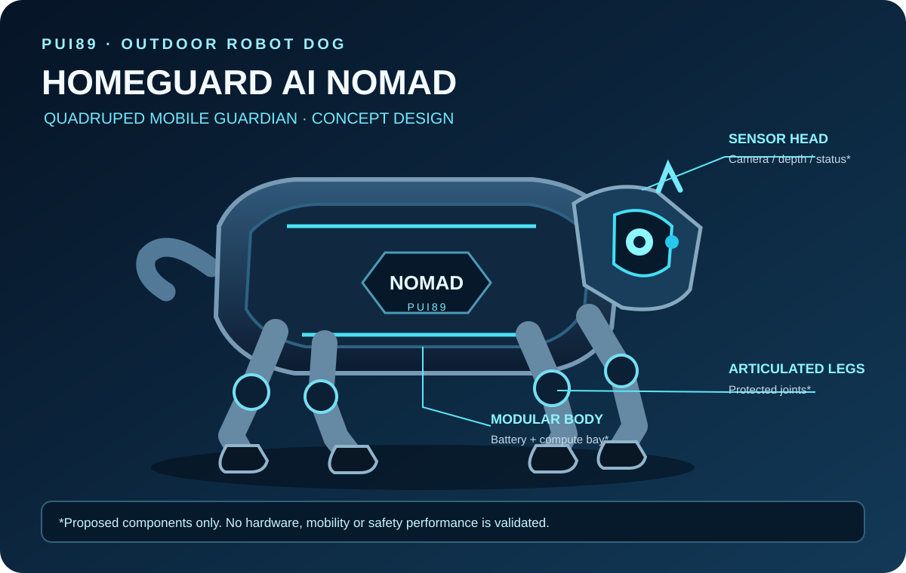
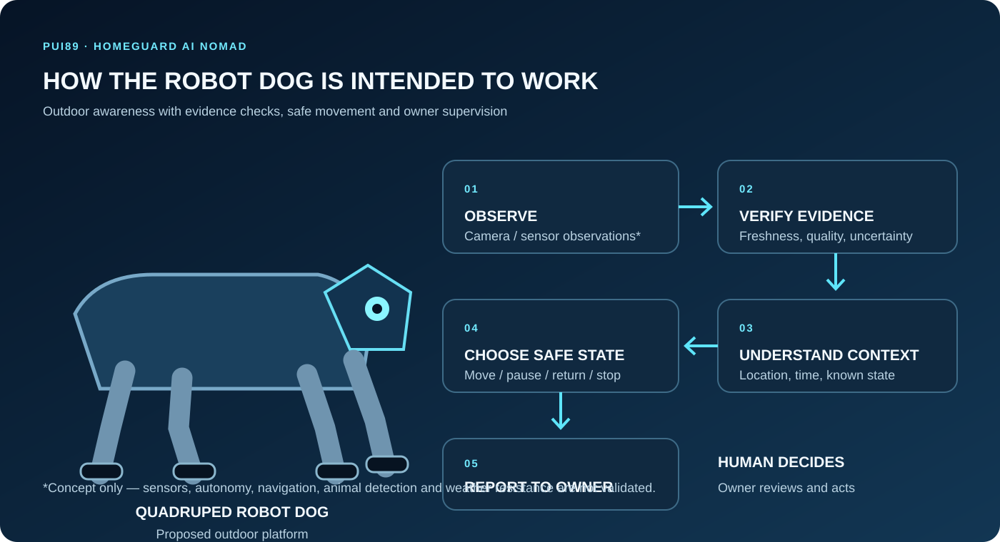

# HOMEGUARD AI NOMAD
### Portable Outdoor Intelligent Guardian

**Your Intelligent Guardian. Wherever You Go.**

> **Product identity:** HOMEGUARD AI NOMAD is the proposed portable mobile-robot product within PUI89's HOMEGUARD AI concept. The repository name is `Homeguard-Ai-Nomad`.

**Detect Early. Locate Precisely. Protect Better.**

<p align="center"></p>


> **How it works:** Observe building conditions → locate each observation → verify evidence quality → understand the building's changing state → recommend human-reviewed action → measure whether the improvement worked.

HOMEGUARD AI is a software-first building-condition intelligence platform. It organizes observations from structural, electrical, fire/life-safety, water, environmental, acoustic, light and thermal sources; compares them with documented baselines; exposes uncertainty; and helps people prioritize verification.

> **Current status: FOUNDATION / SIMULATION-ONLY.** This is an initial deterministic software demonstrator, not a deployed building-monitoring product. No real sensor integration, trained AI model, certified alarm, structural certification or real-world hazard-detection performance is claimed.

## Initial implementation
- Typed, provenance-aware sensor observations and baselines
- Quality checks for stale, missing, invalid and uncalibrated evidence
- Transparent baseline-deviation detection
- Deterministic synthetic three-floor scenario
- Machine-readable JSON findings
- Automated tests and GitHub Actions CI

The 29-capability catalogue is a roadmap, not 29 implemented models. No trained model is required for the first demonstrator.

## HOMEGUARD AI robot family — two purpose-built designs (PROPOSED)

HOMEGUARD AI should use **two separate robot types** rather than forcing one physical platform to perform equally well indoors and outdoors. They share the PUI89 AI Core, evidence model, reporting approach and safety principles, but have different mechanical designs, sensors, navigation and environmental protection.

| Product | Intended environment | Design priority |
|---|---|---|
| **HOMEGUARD AI HOME** | Indoor homes and buildings | Compact, quiet movement; safe navigation around people, furniture and pets; indoor mapping; return to a charging dock |
| **HOMEGUARD AI NOMAD** | Outdoor travel and camping | Suitcase-sized portable platform; four compact wheels; retractable handle; removable battery; supervised outdoor monitoring |

### HOMEGUARD AI HOME — indoor robot concept (PROPOSED)

HOME is a dedicated indoor mobile-robot concept. Its priorities are a compact footprint, low-noise movement, careful navigation through doors and corridors, obstacle and drop-off awareness, privacy-conscious sensing, and reliable docking. Its final dimensions, wheel arrangement, sensor package, battery and charging design remain open engineering decisions; no unverified hardware specification is claimed.

### HOMEGUARD AI NOMAD — quadruped outdoor robot dog (PROPOSED)

NOMAD is a **four-legged mobile robot dog** for owner-supervised outdoor awareness. It is separate from HOME, the indoor robot. Its proposed design has a compact protective body, four articulated legs, a forward sensor head and a removable battery.



*Concept illustration only — not built, tested, certified or validated.*

| Design parameter | Initial target |
|---|---:|
| Robot type | Four-legged quadruped |
| Height | 35–45 cm |
| Body length | 45–55 cm |
| Body width | 28–35 cm |
| Complete weight target | 8–10 kg |
| Absolute maximum complete weight | 12 kg |
| Battery | Removable, protected pack |
| Compute | Local-first, low-power design |

These are engineering targets, not measured specifications. Weight includes battery, computer, sensors and enclosure. Joint torque, balance, runtime, terrain limits, heat dissipation and safe interaction require engineering and testing.

### Intended NOMAD workflow



1. **Observe:** gather available camera, environmental and mobility-state observations.
2. **Verify evidence:** check freshness, sensor health, calibration, missing data and uncertainty.
3. **Understand context:** relate observations to location, time, owner-defined boundaries and robot state.
4. **Choose safely:** continue only within validated limits; pause, return or safe-stop when needed.
5. **Report:** explain observations and uncertainty to the owner for human review.

### Proposed outdoor use cases

- Owner-supervised travel and campsite awareness.
- Report possible environmental changes or smoke/heat indicators only when suitable validated sensors are installed.
- Explore a bounded area and maintain a local map, subject to tested terrain and safety limits.
- Low-light/night operation with privacy-conscious sensing and owner alerts.

NOMAD is an awareness and reporting platform, not a guard dog, weapon, firefighting robot or wildlife-chasing device. It must not pursue people or animals, approach hazards to investigate, or operate beyond defined limits. Human supervision and an accessible stop function are required.

### Safety and environmental protection

- Define tested limits for slopes, stairs, loose ground, wet surfaces, rain, dust, temperature and battery reserve.
- Protect cells, wiring and power electronics against impact, moisture ingress, overcurrent and thermal faults.
- Treat water and fire resistance as engineering requirements that need defined tests; do not claim waterproof, fireproof or explosion-proof performance without evidence and applicable certification.
- Use conservative speed and force limits and provide a safe degraded mode.
- If localization, footing, sensing or communications become unreliable, stop safely.
- Certified alarms and emergency services remain authoritative.

This robot-dog design is a future proposal. No quadruped hardware, autonomous navigation, animal detection, weather rating or real-world safety performance is currently claimed.

## Quick start
Requires Python 3.11+.
```bash
python -m pip install -e ".[dev]"
pytest
homeguard-simulate --seed 89 --output report.json
```

## Safety and privacy
Decision support only. The current software demonstrator does not operate breakers, valves, lifts, doors or alarms; certify a building; or replace qualified professionals. Certified smoke, fire, CO and electrical protection devices remain primary. Never wait for AI analysis before following a certified alarm or established emergency procedure. Minimize personal data; prefer acoustic features over recording conversations; avoid unnecessary indoor video, face recognition and profiling.

## Procurement policy
The initial foundation has no remote inference, model download, paid API, subscription or cloud-GPU dependency. This project excludes Chinese-origin AI models, providers and model-hosting services from its approved stack. Future dependencies require provenance, ownership, licence, security, privacy, network, resource and cost review.

## Evidence labels
PROPOSED = planned; IMPLEMENTED = code exists; TESTED = automated test passed; SIMULATION-ONLY = synthetic inputs only; MEASURED = quantitative result with method; VERIFIED = reproducibly checked; NOT_VALIDATED = real-world performance not established.

See [Architecture](docs/ARCHITECTURE.md), [Safety Case](docs/SAFETY_CASE.md), [Intelligence Catalogue](docs/INTELLIGENCE_CATALOGUE.md), [Supply-chain Policy](docs/MODEL_AND_SUPPLY_CHAIN_POLICY.md) and [Roadmap](docs/ROADMAP.md).

**PUI89 — Intelligent Systems. Verifiable Decisions. Safer Outcomes.**