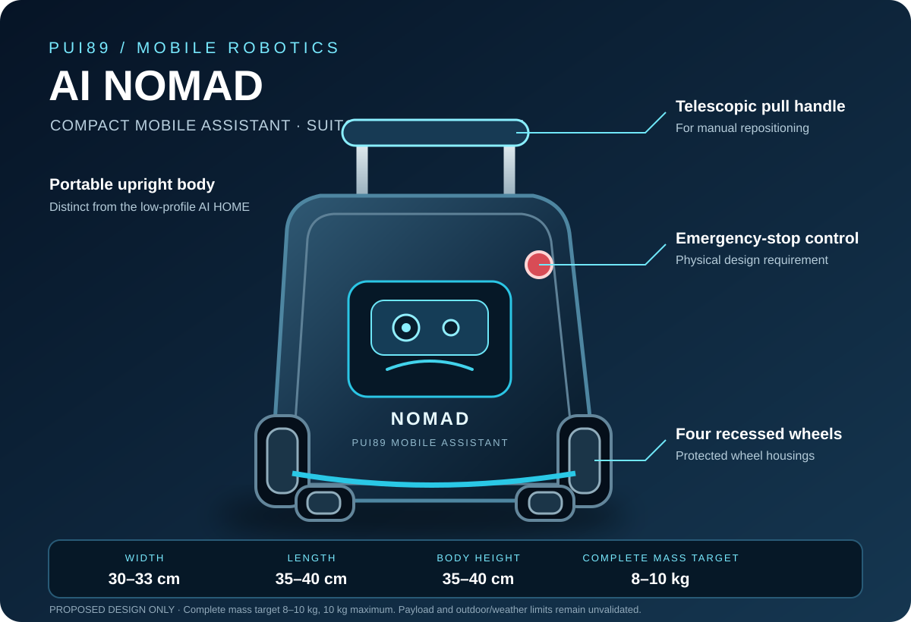
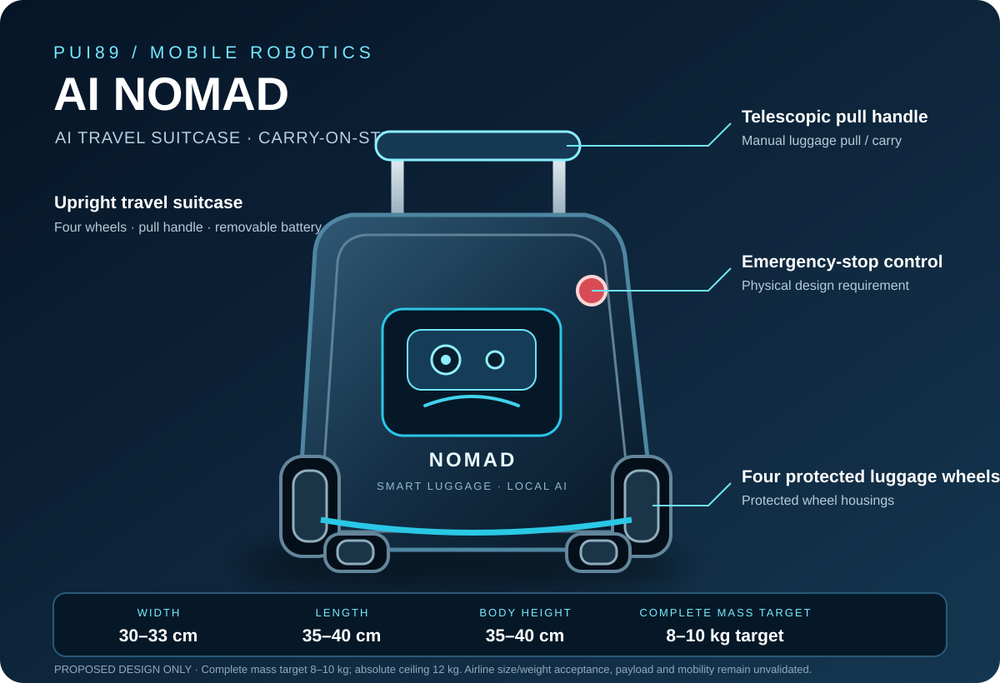
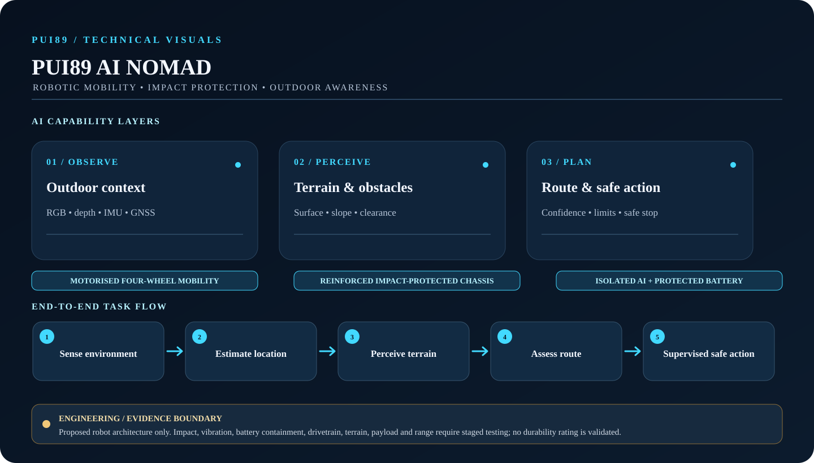

# PUI89 AI NOMAD — Carry-on Suitcase-Style Mobile AI Assistant

## Product and AI system update — 18 November 2026

**Public product summary (EN):** PUI89 AI NOMAD is a suitcase-style, four-wheel ground-use mobile assistant. Its defining form is an upright compact luggage body with exactly four caster wheels at the base, a retractable telescopic pull handle, practical internal storage and a proposed rechargeable battery system. It accompanies its owner during travel; the owner can manually pull it and supervise any future powered assistance.

**เทคโนโลยีและประโยชน์ (TH):** กระเป๋าผู้ช่วยอัจฉริยะเคลื่อนที่บนพื้น มีล้อ 4 ล้อ มือจับลาก ช่องเก็บสัมภาระ และแนวคิดแบตเตอรี่ชาร์จได้ ช่วยจัดการรายการเดินทาง เตือนความจำ สังเกตสิ่งกีดขวางและเหตุผิดปกติ พร้อมส่งการแจ้งเตือนให้เจ้าของ ระบบรักษาความปลอดภัยเป็นฟังก์ชันสนับสนุน ไม่ใช่การรับประกันการป้องกันภัย

**AI technology direction:** computer vision and obstacle/person awareness; proximity sensing; location and route context; edge AI; voice/text travel assistance; owner notifications; event history; battery management/BMS and power-state monitoring. Follow-me or powered rolling is a future research mode and must be validated in a bounded permitted environment.

**Who it serves:** travellers, commuters, older users and people who want useful luggage storage combined with travel assistance and additional owner-supervised security awareness.

**Safety and identity boundary:** NOMAD is not a dog or quadruped; it is not Sentinel. It is not marketed as airline-approved cabin baggage. No physical powered mobility, follow-me performance, battery endurance, obstacle avoidance or security effectiveness is validated. No autonomous pursuit, confrontation or enforcement.

**Project website:** [English](https://pui89.github.io/nomad.html) · [ภาษาไทย](https://pui89.github.io/nomad-th.html) · [PUI89 portfolio](https://pui89.github.io/)

---

<!-- PUI89_PINNED_CONCEPT_ILLUSTRATION:START -->

*Concept illustration built as an embedded SVG. Proposed design only; physical construction and validation remain pending.*

*Conceptual design illustration — not a built or validated robot. Dimensions, weight, mobility, endurance, weather resistance and field performance remain design targets pending engineering and physical validation.*
<!-- PUI89_PINNED_CONCEPT_ILLUSTRATION:END -->

## Product at a glance

**Product direction:** A suitcase-style, four-wheel mobile assistant designed for ground travel and everyday mobility.

**User value:** Combine practical storage with supervised ground mobility and travel-context assistance, without presenting the product as airline-approved luggage.

**Key capabilities and design priorities:** Four luggage-style caster wheels and telescopic handle as design direction; travel-context awareness; supervised rolling mobility; optional assistance and evidence-based alerts.

**Evidence maturity:** **Implemented** — a software foundation for the ground-use four-wheel mobile assistant is documented. Physical mobility, steering, braking, endurance and field performance remain unvalidated.

**Evidence reviewed:** 17 November 2026. See the [shared PUI89 development record](https://pui89.github.io/) for current evidence, limitations and the next milestone.

**Evidence boundary:** The suitcase-inspired form does not establish airline cabin-baggage acceptance; physical mobility and endurance remain unvalidated.

**Project links:** [English website](https://pui89.github.io/nomad.html) · [ภาษาไทย](https://pui89.github.io/nomad-th.html) · [PUI89 portfolio](https://pui89.github.io/)  

---
## Public privacy boundary

This public README is limited to the project overview, approved concept material and evidence that can be shared openly. Do not publish API keys, passwords, private tokens, Wi-Fi or internal network settings, private camera footage, personal or precise location data, detailed security configurations, unreleased engineering specifications, or confidential commercial plans. Keep sensitive material in an appropriately access-controlled private location. If a credential may have been exposed, revoke it; removing it from the latest commit does not remove it from Git history.

## Product identity — PUI89 AI NOMAD, four-wheel carry-on suitcase-style mobile AI assistant

**PUI89 AI NOMAD is a carry-on-suitcase-style mobile AI assistant with exactly four luggage-style swivel caster wheels at the base and a retractable telescopic pull handle.** Its upright, compact rectangular luggage body is intended to look and be handled like a premium travel suitcase. The four base wheels are caster wheels, not legs. NOMAD must never be depicted or described as a dog, quadruped, four-legged robot or animal-shaped machine. The final powered-wheel arrangement, steering, braking and caster configuration remain engineering decisions. The suitcase-inspired form does not establish airline cabin-baggage approval.

NOMAD is deliberately different from **PUI89 Sentinel**, which is the separate four-legged quadruped exploration and inspection robot. Sentinel uses articulated legs; NOMAD uses four luggage-style caster wheels at the bottom of a carry-on suitcase body. Never transfer Sentinel's animal-like or legged design language to NOMAD.

Both products may share PUI89 Shared AI Core interfaces and evidence standards, but their chassis, locomotion, sensors, safety cases and validation plans remain product-specific. NOMAD's physical capabilities remain proposed until a prototype is built and tested.

## Product purpose — a multifunctional travel companion, not a security robot

**PUI89 AI NOMAD is designed first as useful carry-on luggage and a personal travel assistant. Security awareness is a supporting safety function, not the product's identity or primary purpose.** The product combines a practical storage compartment, an upright carry-on suitcase form, four base wheels and a proposed AI-assisted mobility and travel-support system.

### User needs and proposed functions

| User need | Proposed NOMAD support | Evidence boundary |
|---|---|---|
| Carry belongings with less effort | Practical luggage storage, manual pull handle and future motor-assisted rolling | Storage layout and motorised assistance require prototype validation |
| Move through a journey more easily | Travel-context information, route guidance and permitted-area navigation assistance | Depends on reliable data, maps, location inputs and venue rules |
| Keep track of the trip | Itinerary, schedule, checklist and reminder support | External flight/booking data requires an authorised integration; no live feed is assumed |
| Find and organise belongings | User-defined packing lists, compartment organisation and optional item-location aids | Item detection or tracking requires suitable sensors/tags and privacy review |
| Interact naturally | Voice and text interaction, multilingual assistance and clear status feedback | Language quality and offline coverage require evaluation |
| Reduce physical effort | Supervised follow-me and motor-assisted movement research | Future capability; not available or validated today |
| Travel with confidence | Obstacle/person awareness, separation alerts, battery status and emergency stop | Safety functions require independent engineering and physical tests |
| Stay useful without connectivity | Local checklists, reminders, status and other essential offline functions | Exact offline feature set depends on local software and storage |

### Proposed user modes

1. **Luggage Mode:** a conventional manually handled suitcase; the user can pull, park and access belongings.
2. **Assist Mode:** future motor assistance for rolling on a validated surface, with owner supervision.
3. **Follow Mode:** future owner-following in a defined, permitted environment after navigation, privacy and safety validation.
4. **Travel Assistant Mode:** itinerary, reminders, packing checklist, destination notes and travel information from authorised sources.
5. **Navigation Support Mode:** route and wayfinding suggestions for human review; autonomous movement is restricted to separately validated areas.
6. **Manual / Recovery Mode:** direct human handling and a clear way to stop, isolate or recover the unit.
7. **Safe Mode:** stop or hold position when obstacle, localisation, communication, battery or sensor conditions are unsafe or uncertain.

### Product boundaries

- NOMAD is not primarily a security guard, patrol robot, surveillance platform or emergency responder. Security-related sensing is optional and subordinate to travel assistance and safe mobility.
- No unrestricted autonomous movement in airports, hotels, streets or other public spaces is claimed. Venue permission and operating-domain validation are required.
- It does not replace airline staff, airport security, travel agents, emergency services or accessibility professionals.
- Flight status, booking, maps, translation and messaging integrations are proposed only where a reliable, authorised source and suitable privacy controls exist; no paid API or cloud service is assumed.
- Airline cabin-baggage acceptance is not established. Dimensions, total mass and battery transport rules must be checked with each carrier.
- Every capability in this section is a product requirement or research direction unless a separate implementation record and validation evidence explicitly establish it.

## Compact product specification — 8–10 kg target, 10 kg maximum

| Specification | Proposed engineering target |
|---|---:|
| Complete robot mass | **8–10 kg target; 10 kg maximum**, including battery, handle, wiring and installed sensors |
| Payload | **TBD**; define only after stability, traction and total-mass analysis within the 10 kg design limit |
| Body width | **30–33 cm** |
| Body length / depth | **35–40 cm** |
| Body height | **35–40 cm**, excluding the extended handle |
| Mobility | Four luggage-style swivel caster wheels at the base; powered-wheel arrangement, steering and braking to be selected after engineering analysis |
| First operating domain | Indoor, flat, controlled surfaces; owner-supervised |
| Later operating domain | Selected outdoor surfaces only after separate validation |
| Compute direction | CPU-first, low-power, local/offline-capable AI; no automatic model or package downloads |
| Human control | Manual override, physical emergency stop and conservative safe-stop behaviour |

The 10 kg maximum is the complete robot design-mass limit, including the battery, handle, wiring and installed hardware. Payload capacity is not yet specified and must be established through structural, traction, braking and stability analysis; do not add an assumed payload above the 10 kg limit. The handle's extended height is excluded from body height, but its mass is included in the complete robot mass.

**Status: PROPOSED / NOT MEASURED / NOT VALIDATED.** These are design targets, not measured prototype specifications. No physical NOMAD robot, payload rating, runtime, speed, braking distance, obstacle-clearance limit, ingress rating or field reliability is established.

### Preliminary 10 kg complete-robot mass-allocation budget

| Assembly | Planning allocation |
|---|---:|
| Frame and enclosure | 2.2 kg |
| Wheels, motors and drivetrain | 2.0 kg |
| Battery and power protection | 1.5 kg |
| Compute and control electronics | 0.8 kg |
| Cameras and other sensors | 0.6 kg |
| Handle, wiring and safety hardware | 1.0 kg |
| Engineering allowance / mass reserve | 1.9 kg |
| **Complete robot mass budget** | **10.0 kg** |

This is a top-down planning allocation only. It is not a supplier-based bill of materials or measured component inventory. The engineering allowance is reserved within the 10.0 kg ceiling; it must not be treated as extra mass above the limit. Component selection must be supported by exact part numbers, verified mass, origin evidence, availability, compatibility and dated sourcing records before design freeze.

### First buildable product: NOMAD Carry-on Prototype 1

The first physical prototype should prioritise a dependable supervised carry-on-luggage-style rolling platform over complex autonomy:

- Carry-on suitcase-style upright enclosure with four protected swivel caster wheels at the bottom corners, a low-mounted battery and a stable internal payload area.
- Appropriately sized motor/drive system, wheel encoders and a controller; final drive layout and torque remain to be calculated.
- Protected battery, fuse/over-current protection, accessible isolation, thermal monitoring and safe wiring.
- Physical emergency stop and manual recovery/control method.
- Basic camera observation and obstacle alerts; optional depth sensing only after compute, power, cost and provenance review.
- Battery/state telemetry and clear owner-facing status.
- CPU-first local software, with deterministic control and safety functions kept separate from AI perception.
- AI outputs are observations or bounded recommendations; they are not direct authority to drive actuators.

**Not in Prototype 1:** unsupervised owner-following, public-space autonomy, stair climbing, all-terrain travel, water crossing, waterproof claims, emergency response or autonomous road operation. These require separate engineering, risk assessment and validation.

### Engineering and validation gates

1. **Requirements and CAD packaging:** confirm body envelope, access for service, handle loads, payload location, centre of gravity and wheel guarding.
2. **Mass closure:** maintain a part-by-part mass ledger, including fasteners, wiring, connectors, guards, handle and battery; demonstrate a design total at or below 10.0 kg with the stated reserve.
3. **Mechanical and drive analysis:** calculate static/dynamic wheel loads, motor torque, traction, turning clearance, slope limits, braking and stopping distance within the 10.0 kg maximum complete-robot mass; payload remains TBD.
4. **Electrical and thermal safety:** define battery chemistry/capacity only after runtime and power budgeting; verify fusing, isolation, charge protection, wiring, thermal limits and emergency stop.
5. **Software-in-the-loop:** test command limits, stale/missing sensors, communication loss, low battery, obstacle states, safe hold and recovery using deterministic tests and documented simulation.
6. **Controlled physical trials:** begin unloaded at low speed in a closed, flat indoor area; then increase payload and test braking, stability, turning, thresholds and endurance under supervision.
7. **Operating-domain expansion:** different floor surfaces, thresholds, ramps, rain/splash and dust each require their own acceptance criteria and evidence before being described as supported.

**Release rule:** do not publish a measured weight, payload rating, runtime, speed, slope limit, ingress rating or safety claim until the method, conditions, results and supporting evidence are recorded. Simulation and software tests do not prove physical performance.

## Open-source-first engineering

PUI89 prioritises open-source software, transparent licensing, reproducible workflows and evidence-led collaboration. Model weights, datasets, hosted services and hardware are assessed separately for provenance, licence terms, security, data handling, resource requirements and intended use. Public availability alone does not establish permission for reuse or commercial deployment.

> **PUI89 engineering standard:** [Simple, Safe and Professional](https://github.com/Pui89/Pui89.github.io/blob/main/docs/PUI89_SIMPLE_SAFE_PROFESSIONAL_STANDARD.md) — shared guidance for usability, safety, evidence, privacy and maintainable engineering.

> **PUI89 | Intelligent Systems. Verifiable Decisions. Safer Outcomes.**
> 
> **Project:** PUI89 AI Mobile Assistant Robot  
> **Focus:** Owner-supervised compact four-wheel mobile assistant robot concept  
> **Development stage:** Early software foundation and design targets; locomotion, endurance and field performance are not validated.
> 
> **Project website:** [English](https://pui89.github.io/nomad.html) · [ภาษาไทย](https://pui89.github.io/nomad-th.html) · [PUI89 portfolio](https://pui89.github.io/)
> 
> **Validation boundary:** Proposed dimensions and weight are design targets, not measured prototype specifications; AI Mobile Assistant Robot is not an emergency responder or unsupervised roaming system.

## Hardware & Materials Sourcing

PUI89 uses a traceable sourcing workflow for materials, mechanical parts, sensors, compute, power and control components. See the [bilingual Hardware & Materials Sourcing guide](https://pui89.github.io/materials.html) for the process covering exact manufacturer/model identification, Thailand and international supplier discovery, country-of-origin evidence, dated pricing and availability, lead times, shipping, compatibility checks and verification gates. Product-specific candidates are added only when supported by evidence; research candidates are not purchases or validated hardware.

### Prototype materials & cost snapshot

**Planning allowance for one research prototype: ฿36,000–107,000.** This is a preliminary estimate from the [PUI89 project-specific BOM](https://pui89.github.io/materials.html#project-boms), not a supplier quotation or verified current market price.

Compact carry-on suitcase-style mobile assistant with four base caster wheels and a retractable telescopic handle; 8–10 kg target and 10 kg maximum complete-robot design mass.

| Main item | Prototype quantity | Purpose |
|---|---:|---|
| Carry-on suitcase shell and internal frame | 1 set | Upright luggage body structure |
| Powered wheel/motor modules | TBD | Select only after comparing powered-wheel and passive-caster layouts; do not assume four drive motors |
| Spinner caster wheels | 4 | Luggage-style swivel wheels at the four base corners; final load rating and wheel material TBD |
| Retractable handle | 1 | Manual handling |
| RGB-D camera + 2D LiDAR | 1 each shared | Perception and navigation |
| IMU/position sensors | 1 set | Motion and location |
| Battery/BMS | 1 set | Protected power |
| Compute/motor control | 1 set | Reuse shared compute where suitable |

**Special engineering / purchase gate:** Validate luggage-shell strength, centre of gravity, handle locking, four caster mounts/load ratings, rolling stability, braking/holding, battery safety and low-speed supervised stop behaviour. The 8–10 kg target and 10 kg maximum are design targets, not verified payload or performance.

**Shared engineering bench (tracked separately):** approximately ฿16,500–46,000 if the existing development computer is reused. This is a portfolio-level allowance for reusable compute, one RGB-D camera, bench power supply/multimeter, two microcontroller boards and reusable tools/wiring/adapters; it is not added to each project total. Allocate each shared item once, not once per product.

**Cost status:** exact manufacturer/model, manufacturing origin, supplier, stock, lead time and dated prices remain to be verified. Freight, insurance, duty, VAT, brokerage, local delivery, custom fabrication labour and certification are not priced here; calculate Thai landed cost only from dated quotations. Quantities are for one prototype; no purchase or supplier commitment is authorised. Software-first work can continue with available computing and appropriately licensed open-source tools before hardware procurement.

## Perception & Task Intelligence (PTI)

**Role in this product:** support supervised luggage-style rolling mobility and travel assistance for the compact four-wheel NOMAD assistant. PTI is the shared PUI89 perception-and-task framework; the tasks below are research priorities, not validated travel-ready or autonomous capability.

**Priority perception tasks**
- Check camera/depth/IMU input quality, timestamps, calibration state and sensor availability.
- Detect people, objects, path boundaries and obstacles relevant to the planned route.
- Estimate floor-surface changes, thresholds, ramp limits and obstacle clearance only when suitable depth/spatial inputs and validation evidence are available.
- Fuse localisation, inertial and perception observations; detect stale data, sensor disagreement and localisation loss.
- Identify routes or surfaces outside the validated operating envelope and request human guidance.
- Propose only bounded routes in a defined, supervised operating area; safe-hold when conditions are uncertain.

**Task flow:** OBSERVE → PERCEIVE → ASSESS → DECIDE → RESPOND → LEARN FROM EVIDENCE. Outputs support a human supervisor; they do not authorise unrestricted navigation or physical movement beyond separately validated safeguards.

**First evidence gate:** controlled indoor travel-route datasets and synthetic obstacle/threshold cases, then supervised low-speed trials only after independent hardware safety provisions exist. Measure obstacle misses, localisation error, stop response, recovery behaviour and compute/resource use.

**Not established:** stair/escalator traversal, public-road autonomy, payload or mobility limits, airline acceptance, or field-validated navigation. See the [shared PTI specification](https://github.com/Pui89/PUI89-Shared-AI-Core/blob/main/docs/perception/PUI89_PERCEPTION_TASK_INTELLIGENCE_V1.0.md) (maintainer repository access required).

## Six Core Intelligence Groups — Product Allocation

PUI89 uses six shared intelligence groups across its six active products. This product allocation is a target architecture and capability map; it does not claim that every model, sensor, integration or physical function is implemented or validated.

- Vision Intelligence — image/video understanding, detection, classification, segmentation, tracking, depth and spatial cues.
- Audio Intelligence — speech recognition, sound/event perception, speaker diarisation where justified, audio-visual association, acoustic diagnostics and speech response.
- Multimodal Intelligence — context-aware fusion of vision, audio, text, video and authorised sensor/time-series data with provenance and uncertainty.
- Robotics Intelligence — robot/environment understanding, localisation, navigation, motion planning and manipulation where the product has suitable hardware.
- Action & Reaction Intelligence — task planning, bounded proposals, event response, prediction, recovery and escalation.
- Safety & Control Intelligence — independent permissions, operating limits, verification, human approval, fault handling, safe hold and emergency-stop boundaries.

### PUI89 AI NOMAD capability allocation

- **Vision:** Travel environments, people, luggage, doors, walkways, floor surfaces, thresholds and obstacles.
- **Audio:** Voice interaction and relevant travel-environment sound awareness, subject to privacy and validation.
- **Multimodal:** Camera/depth/IMU and optional LiDAR, GNSS or audio context fusion when justified by the travel scenario.
- **Robotics:** Supervised low-speed rolling mobility, route awareness and manual recovery planning; owner-following remains a future research topic requiring separate validation.
- **Action & Reaction:** Obstacle alerts, route-context changes, localisation loss, low-battery and motor/system anomaly reporting.
- **Safety & Control:** Owner supervision, validated-area limits, obstacle stop, manual pull/recovery and safe hold.

**Integration rule:** each product uses only the modules justified by its mission, data rights, hardware, compute budget and validation evidence. Model outputs remain observations or bounded proposals. Safety policy is product-specific and independent of model confidence. Unknown, stale, conflicting or out-of-scope inputs must be surfaced rather than guessed.

**Evidence status:** proposed capability allocation unless a separate implementation record, reproducible test or domain-specific validation explicitly says otherwise. Audio models, speaker diarisation, sound classifiers, VLM/VLA policies and robotics stacks require separate provenance, licence, compute, privacy and suitability review before adoption. No automatic model download or installation is authorised.

### Six-intelligence concept visual

*Concept diagram only: it illustrates intended software intelligence domains, not a built product, installed model stack, integrated sensor suite or validated capability.*

## Development stage

**Current stage:** Early software foundation & design targets  
**ขั้นการพัฒนา:** พื้นฐานซอฟต์แวร์และเป้าหมายการออกแบบระยะแรก

**Evidence:** Concept requirements, architecture and early deterministic software foundations are documented.

**Limitations:** No built robot, validated four-wheel mobility, endurance, weather protection or field performance is established.

**Next milestone:** Complete a software-only mission and hazard-state demonstrator.

## Project website QR codes

<table><tr><td align="center"><strong>English website</strong>  <a href="https://pui89.github.io/nomad.html">Open English website</a></td><td align="center"><strong>เว็บไซต์ภาษาไทย</strong>  <a href="https://pui89.github.io/nomad-th.html">เปิดเว็บไซต์ภาษาไทย</a></td></tr></table>
### A Multifunctional Carry-on Travel Companion

**A mobile companion designed to help people indoors and outdoors.**

PUI89 AI NOMAD is an early-stage, owner-supervised mobile AI assistant in an upright carry-on suitcase form, with four spinner caster wheels at the base and a retractable telescopic pull handle. It is intended to support supervised luggage carrying, travel and environmental awareness. These are design goals, not validated capabilities; airline cabin-baggage acceptance is not established.

- **Repository:** https://github.com/Pui89/AI-Mobile-Assistant-Robot
- **Website:** [English](https://pui89.github.io/nomad.html) · [ภาษาไทย](https://pui89.github.io/nomad-th.html)
- **Separate indoor home-safety product:** [PUI89 AI HOME](https://github.com/Pui89/AI-Home-Safety-Robot) · [English website](https://pui89.github.io/home.html) · [ภาษาไทย](https://pui89.github.io/home-th.html)

> **Product boundary:** AI NOMAD is a carry-on suitcase-style mobile assistant concept for supervised travel, luggage carrying and suitable everyday mobility. HOME is a separate four-wheel indoor home-safety robot. The products may share versioned PUI89 AI Core contracts, but they are not one robot and do not share physical operating assumptions.

## PUI89 AI NOMAD purpose

AI NOMAD is intended as a practical carry-on suitcase and owner-supervised personal travel companion—not merely a security or surveillance robot. Proposed research areas include:
- Rolling and carrying personal belongings in a compact upright luggage body
- Four-wheel spinner-caster handling and supervised movement in suitable indoor environments
- Travel assistance and environmental awareness in stations, terminals and other permitted settings, subject to access rules and validation
- Optional owner-accompaniment research only after separate safety, privacy and navigation validation concepts
- Indoor/outdoor scene and obstacle awareness
- Mapping and localization research, with safe-stop behaviour when uncertain
- Environmental observations when suitable sensors are selected and validated
- Offline-first operation and clear owner-facing reports

AI Mobile Assistant Robot is not an emergency responder or an unsupervised roaming machine. It must not enter hazardous areas merely to investigate. Carrying capacity, following behaviour, accessibility support and safe operation remain unvalidated design goals.

## Proposed operating workflow

Observe → check evidence quality → understand location and context → assess uncertainty and risk → choose a safe movement state → report to the owner.

The owner remains responsible for decisions. If localization, route safety or battery reserve is insufficient, the robot should stop safely rather than attempt an unsafe return or continue moving.

## Safety and resilience requirements

- Define and test separate limits for indoor floors, thresholds, stairs, people, pets, rain, dust, temperature, slopes, loose ground, water exposure, darkness, battery endurance and connectivity.
- Prioritize battery protection, electrical isolation, overcurrent protection, thermal monitoring and guarded wiring.
- Treat weather resistance, water resistance and fire performance as engineering requirements requiring specified tests; do not claim waterproof or fireproof performance.
- Never delay emergency response or substitute for certified alarms and qualified responders.
- Use human supervision, safe-stop defaults and clear uncertainty reporting.
- Protect location data and avoid unnecessary recording of people.

## Shared intelligence, separate product engineering

AI Mobile Assistant Robot may reuse PUI89 AI Core contracts (WorldState, Observation, ActionProposal and FailureReport), evidence provenance, uncertainty handling, safety gates, benchmark records and report formats. Its four-wheel spinner-caster layout, any powered-wheel arrangement, travel-context perception, environmental protection and risk assessment remain AI NOMAD-specific.

## Current development status

**FOUNDATION / SIMULATION-ONLY / CONCEPT.** The repository contains an early deterministic software foundation, documentation and automated tests. It does not establish a built robot, real sensor integration, trained AI model, validated locomotion, indoor/outdoor reliability, certified safety or real-world hazard-detection performance.

## local-first and supply-chain policy

External services and model downloads require prior origin, licensing, security and resource review. PUI89 excludes Chinese-origin AI models, providers and model-hosting services from its approved stack.

## Evidence labels

PROPOSED = planned; IMPLEMENTED = code exists; TESTED = automated test passed; SIMULATION-ONLY = synthetic inputs only; MEASURED = quantitative result with method; VERIFIED = reproducibly checked; NOT_VALIDATED = real-world performance not established.

See [Architecture](docs/ARCHITECTURE.md), [Safety Case](docs/SAFETY_CASE.md), [Intelligence Catalogue](docs/INTELLIGENCE_CATALOGUE.md), [Supply-chain Policy](docs/MODEL_AND_SUPPLY_CHAIN_POLICY.md), [Roadmap](docs/ROADMAP.md), [Water Resilience Standard](docs/PUI89_WATER_RESILIENCE_STANDARD.md) and [Resilience Standard](docs/PUI89_RESILIENCE_STANDARD.md).

**PUI89 — Intelligent Systems. Verifiable Decisions. Safer Outcomes.**

## Hugging Face vision models — opt-in local integration

This repository now includes real Hugging Face checkpoint adapters in [`pui89_models/hf_vision.py`](pui89_models/hf_vision.py), with project-specific usage boundaries in [`docs/HUGGING_FACE_MODEL_INTEGRATION.md`](docs/HUGGING_FACE_MODEL_INTEGRATION.md).

- **OWLv2:** `google/owlv2-base-patch16-ensemble` for text-conditioned object proposals.
- **Intel DPT-Hybrid:** `Intel/dpt-hybrid-midas` for relative scene depth where appropriate; not calibrated distance or physical depth.
- **local-first default:** no packages or model weights are installed/downloaded automatically; CPU-only inference, local cache only by default, no hosted inference API or cloud GPU.
- **Evidence status:** adapter code is added; model inference and project-specific accuracy are NOT YET TESTED. Outputs remain uncertain observations for human review, never actuator commands.

---

## Security, malware and supply-chain protection

Security policy: [SECURITY.md](SECURITY.md). Report suspected vulnerabilities privately; do not post travel routes, precise locations, credentials or private sensor records publicly.

Project-specific controls and review requirements:
- Treat GPS, location, environmental sensors, camera/audio, maps, downloaded files and external messages as untrusted inputs.
- Validate timestamps, source provenance, ranges, replay/stale data and offline behaviour.
- Never commit credentials, private travel histories, home addresses or identifiable recordings.
- Review packages, model files, simulator plugins and GitHub Actions for provenance, licence and vulnerability risks before adoption.
- AI suggestions must not directly control mobility, locks or safety-critical hardware; require human approval and safe-stop behaviour.
- Keep CI permissions minimal and never expose secrets to untrusted pull-request code.

A scan or passing test is evidence only for the checks actually run; it does not establish whether the repository contains malware or vulnerabilities.

## PUI89 seven-dimension quality recommendations

**Last reviewed: 8 November 2026 · Review month: November 2026**

This project uses the shared PUI89 quality framework. The indicators are guidance/status labels, not scores, certification or proof that work is complete.

| Dimension | Recommendation for this project | Indicator |
|---|---|---|
| Brand identity | Maintain the PUI89 Deep Navy + Electric Cyan system, consistent project naming and the approved project accent. | 🔵 Guidance |
| Website and accessibility | Keep English and Thai pages aligned, responsive, accessible, correctly linked and date-stamped. | 🔵 Guidance |
| AI software and applications | Version contracts, preserve provenance, propagate uncertainty, abstain on insufficient evidence and test safe human-review boundaries. | 🟢 Quality target |
| Physical products and robotics | Define measurable structural, power, thermal, water-ingress, fire-risk, maintenance and emergency-stop requirements; do not claim untested ratings. | 🟠 Evidence required |
| Documentation and research evidence | Maintain architecture, requirements, reproducible tests, data/model licences, limitations and traceable evidence links. | 🔵 Guidance |
| Product and commercial readiness | Validate the user problem, intended operator, value, support model, lawful IP/data position and release gates before commercial claims. | 🟠 Evidence required |
| Professional environment and presentation | Use consistent technical diagrams, demonstrations and partner-facing materials; do not imply facilities or partnerships without evidence. | ⚪ Not assessed |

**Project-specific priority:** Keep AI NOMAD distinct from indoor HOME as a compact carry-on suitcase-style travel assistant. Prioritise luggage-like handling, four spinner caster mounting, stability, obstacle awareness, battery isolation, offline behaviour, handle durability, serviceability and supervised operation; dimensions, weight, powered-wheel architecture, endurance and weather protection remain design targets until measured.

**Status legend:** 🔵 framework guidance added · 🟢 engineering quality target · 🟠 evidence or validation still required · ⚪ not assessed. These labels describe the review state of recommendations, not overall project maturity. Project maturity changes only when supported by verified repository evidence, reproducible tests or controlled validation.

<!-- PUI89_PROJECT_STRENGTH_SCORECARD:START -->
## PUI89 Project Strength Scorecard | เกณฑ์ประเมินความแข็งแกร่งของโครงการ

**Current review status: Not yet scored · Completed evidence-backed strength reviews: 0.** This is a recordkeeping status, not a claim that no development or testing exists.

**สถานะการประเมิน: ยังไม่มีคะแนน · รายงานประเมินที่เสร็จสมบูรณ์และมีหลักฐาน: 0 รายการ** ตัวเลขนี้หมายถึงจำนวนรายงานที่บันทึกครบตามเกณฑ์ ไม่ได้หมายความว่าไม่มีการพัฒนาหรือทดสอบ

### Four Project Indicators | ตัวชี้วัดโครงการ 4 ด้าน

| Indicator / ตัวชี้วัด | What it measures / สิ่งที่ประเมิน | Current status / สถานะ |
|---|---|---|
| Engineering Strength / ความแข็งแกร่งทางวิศวกรรม | Verified technical capability and system integration / ความสามารถทางเทคนิคและการเชื่อมต่อระบบที่ตรวจสอบได้ | Not yet assessed / ยังไม่ได้ประเมิน |
| Evidence Confidence / ความเชื่อมั่นของหลักฐาน | Evidence traceability, reproducibility and validation quality / การตรวจสอบย้อนกลับ การทำซ้ำ และคุณภาพการตรวจสอบ | Not yet assessed / ยังไม่ได้ประเมิน |
| Implementation Level / ระดับการพัฒนาที่ดำเนินการแล้ว | Work actually implemented, separated from proposed work / งานที่พัฒนาแล้วจริง แยกจากงานที่เป็นข้อเสนอ | Not yet assessed / ยังไม่ได้ประเมิน |
| Project Maturity / ความสมบูรณ์ของโครงการ | Evidence-based development stage, from concept to operational demonstration / ระยะการพัฒนาที่อ้างอิงหลักฐาน ตั้งแต่แนวคิดถึงการสาธิตการใช้งานจริง | Formal stage assessment pending / รอการประเมินระดับอย่างเป็นทางการ |

These four indicators are separate from the weighted 100-point score below. No score, percentage or maturity stage is assigned until a dated evidence-backed review is completed.

ตัวชี้วัดทั้ง 4 ด้านนี้แยกจากคะแนนถ่วงน้ำหนัก 100 คะแนนด้านล่าง จะไม่กำหนดคะแนน เปอร์เซ็นต์ หรือระดับความสมบูรณ์จนกว่าจะมีรายงานประเมินที่ลงวันที่และมีหลักฐานครบถ้วน

| Dimension / ด้านประเมิน | Weight / น้ำหนัก |
|---|---:|
| Technical capability / ความสามารถทางเทคนิค | 25 |
| Testing and evidence / การทดสอบและหลักฐาน | 25 |
| Safety and reliability / ความปลอดภัยและความน่าเชื่อถือ | 20 |
| Engineering maturity / วุฒิภาวะทางวิศวกรรม | 15 |
| Documentation and reproducibility / เอกสารและการทำซ้ำผล | 10 |
| Real-world validation / การตรวจสอบในโลกจริง | 5 |
| **Total / รวม** | **100** |

Scores are awarded only through a dated review with a defined scope, version/commit, evidence links, findings, limitations and next actions. Concepts, planned features, concept images, unrun tests and tool inventories do not earn implementation or test credit. Simulation results do not prove physical-world performance.

จะให้คะแนนเมื่อมีรายงานที่ระบุวันที่ ขอบเขต เวอร์ชัน/commit ลิงก์หลักฐาน ข้อค้นพบ ข้อจำกัด และขั้นตอนถัดไปเท่านั้น แนวคิด ฟีเจอร์ที่วางแผน ภาพแนวคิด การทดสอบที่ยังไม่ได้รัน และรายการเครื่องมือ จะไม่ได้คะแนนว่าเป็นการพัฒนาหรือการทดสอบที่เสร็จแล้ว ผลจำลองไม่ใช่หลักฐานยืนยันประสิทธิภาพในโลกจริง

**Scoring method / รายละเอียดเกณฑ์:** [English](https://github.com/Pui89/Pui89.github.io/blob/main/docs/PROJECT_STRENGTH_SCORECARD.md) · [ภาษาไทย](https://github.com/Pui89/Pui89.github.io/blob/main/docs/PROJECT_STRENGTH_SCORECARD_TH.md)

This project-strength review is separate from the documented development stage; it is not certification, safety approval or an investment rating.
<!-- PUI89_PROJECT_STRENGTH_SCORECARD:END -->

## Spatial Intelligence integration

See [the project-specific spatial integration profile](docs/spatial-intelligence/README.md). Runtime sensor integration and physical validation remain pending.

<!-- PUI89_EVIDENCE_BACKED_REVIEW:START -->
## Evidence-backed project review status

**Project:** PUI89 AI NOMAD  
**README snapshot (13 November 2026): 0 completed evidence-backed reviews.** This snapshot is not auto-synchronised; the live [PUI89 portfolio review register](https://pui89.github.io/#evidence-backed-project-reviews) is the source of truth.

This is a review-record count, not a statement that development or testing has not occurred. Engineering work, CI runs, test results and simulation evidence may support a review, but do not automatically count as a completed review.

A review is counted only when its record includes all required fields: **completed status, review date, defined scope, reviewer role, outcome, and at least one supporting evidence reference**. Drafts, ratings, stars, page views and comments are excluded.

The portfolio-wide count is published on the [PUI89 website](https://pui89.github.io/#evidence-backed-project-reviews). Refresh this README snapshot when the shared register changes.

**สถานะการทบทวนโครงการที่มีหลักฐาน**  
**จำนวนการทบทวนที่เสร็จสมบูรณ์: 0** — ยังไม่มีบันทึกการทบทวนที่ผ่านเกณฑ์สำหรับโครงการนี้ในทะเบียนกลาง PUI89

ตัวเลขนี้เป็นจำนวนบันทึกการทบทวน ไม่ได้หมายความว่าไม่มีการพัฒนาหรือทดสอบ งานวิศวกรรม ผล CI การทดสอบ และหลักฐานจากการจำลองอาจใช้ประกอบการทบทวน แต่ไม่นับเป็นการทบทวนที่เสร็จสมบูรณ์โดยอัตโนมัติ

จะนับเมื่อมีสถานะเสร็จสมบูรณ์ วันที่ ขอบเขต บทบาทผู้ทบทวน ผลการทบทวน และหลักฐานอ้างอิงอย่างน้อยหนึ่งรายการครบถ้วนเท่านั้น รายการร่าง คะแนน ดาว ยอดเข้าชม และความคิดเห็นจะไม่นับ
<!-- PUI89_EVIDENCE_BACKED_REVIEW:END -->

## AI Engineering Intelligence & Carry-on Travel-Assistant Design

NOMAD uses a staged, owner-supervised engineering approach. Its current product target is 8–10 kg complete robot mass, with a 10 kg maximum including battery, handle and installed hardware. Payload capacity remains TBD and must not be assumed above this design limit. The proposed body envelope is 30–33 cm wide × 35–40 cm deep × 35–40 cm high, excluding the extended handle. These are design targets only and do not establish compliance with any airline's carry-on baggage limits.

**Project-specific priorities:** stable load distribution and low centre of gravity; four spinner caster mounts; suitable powered-wheel decision (if required); controlled rolling, turning and braking; protected battery and thermal design; durable telescopic handle; manual pull/recovery; obstacle awareness; offline operation; maintainable luggage-style enclosure; and clear safe-stop behaviour. Indoor controlled operation is the first physical validation domain. Outdoor use is a later, separately gated objective.

**Evidence gates:** CAD and mass ledger → mechanical/electrical analysis → deterministic software tests and documented simulation → supervised low-speed closed-area trials → payload, stability, braking, endurance and environmental validation. Proposed mobility limits are not established capabilities.

---

## Preliminary Prototype Cost Estimate (15 November 2026)

**Indicative one-unit engineering prototype planning range: ฿150,000–฿450,000 (THB).**

**Included at a planning level:** A compact four-wheel mobile platform, drive/braking system, battery, perception/navigation sensors, handle and integration. This is a separate cost target from the current 8–10 kg target (10 kg maximum) and payload requirements, subject to mass-ledger validation; mass and payload must be reconciled before procurement.

**Estimate status:** preliminary internal planning estimate only; not a supplier quotation, purchase commitment, verified bill of materials, fixed project budget or claim that a prototype exists. The range depends on final requirements, component selection, non-Chinese-origin supplier availability, compatibility, import/shipping costs and test scope. Obtain current written quotations and verify country of manufacture/origin, exact model/part number, specifications, warranty and lead time before any procurement.

**Generally excluded:** engineering labour, research salaries, facilities, taxes/VAT, import duties, shipping unless stated in a supplier quotation, certification/regulatory approvals, production tooling, mass production, long-term maintenance and contingency. Project-specific exclusions: any major custom manufacturing or certification not specified in the prototype scope.

**Lower-cost development path:** continue software-first development, open-source tools and simulation before purchasing physical hardware. Shared AI Core software and reusable development equipment may reduce duplicated costs; savings are not yet quantified. No purchase or installation is authorised by this estimate.

### Prototype hardware, materials and component budget breakdown

**Planning scope:** one engineering prototype; total planning range remains **฿150,000–฿450,000 THB**. The following subsystem allowances are preliminary engineering estimates, not supplier quotes. Individual ranges are not a promise of purchase price and must be reconciled against exact selected parts and written quotations before procurement.

| Subsystem / component type | Qty per prototype | Material / specification and function | Indicative allowance (THB) |
|---|---:|---|---:|
| Carry-on suitcase shell + caster mounting | 1 set | Upright luggage enclosure, internal frame, corner protection and four caster mounts | ฿25,000–฿75,000 |
| Optional powered-wheel modules + encoders | TBD | Motorisation and motor count remain undecided; compare passive caster handling and powered-wheel options before estimating | TBD |
| Wheels + brakes + bearings | 1 set | Four swivel spinner casters, bearings, mounting plates and replaceable wear parts | ฿10,000–฿35,000 |
| RGB-D / camera + LiDAR + IMU | 1 set | Travel-scene perception selected for indoor terminal lighting, movement and vibration | ฿25,000–฿75,000 |
| Edge computer + motor controller | 1 set | CPU-first edge computer, MCU and protected motor-control electronics | ฿20,000–฿60,000 |
| Battery + BMS + power | 1 set | Protected battery pack, BMS, fuse, isolation and DC/DC conversion | ฿15,000–฿40,000 |
| Handle, enclosure + environmental protection | 1 set | Retractable telescopic pull handle, luggage-style housing, seals and strain relief | ฿10,000–฿35,000 |
| Harness, fabrication + integration tests | 1 lot | Wiring, brackets, assembly, low-speed stability/braking/endurance tests | ฿25,000–฿70,000 |

**Material families:** aluminium alloy or stainless-steel structural members where suitable; engineering polymer covers; corrosion-resistant fasteners; rated cables/connectors; protective enclosures; and product-specific seals, guards or vibration isolation. Exact alloy/grade, IP rating, load rating and country of manufacture remain unselected until engineering calculations and supplier evidence are available.

**Shared hardware accounting:** Shared AI Core software is not a product BOM. Reusable development computers, cameras or bench instruments must be listed as shared assets and allocated once; do not duplicate their full purchase cost across all six active products. Product-specific mounts, wiring, protection and integration remain in each product allowance.

**Sourcing controls:** prefer non-Chinese-origin candidates only when the exact manufacturing origin is evidenced. Record legal manufacturer, brand, exact model/part number, manufacturing country, evidence URL/document, authorised supplier, dated price/currency, stock, MOQ, lead time, warranty and landed-cost assumptions. Brand headquarters or seller location is not proof of manufacturing origin. Unknown origin = **UNVERIFIED**.

**Prototype boundary:** the allowance is for a controlled engineering prototype, not a certified commercial product or production-ready system. It excludes labour, research salaries, facilities, VAT/tax, import duties, freight/insurance unless explicitly quoted, certification, production tooling, mass production, maintenance and contingency. No purchase, download, installation or supplier commitment is authorised by this documentation.

## Shared Interaction Intelligence — AI NOMAD

AI NOMAD selects a mobile-assistant interaction profile from the [PUI89 Shared AI Core](https://github.com/Pui89/PUI89-Shared-AI-Core):

- Operator/resident voice commands and spoken status reports.
- Thai/English speech recognition and speech response, subject to measured language quality.
- Voice activity detection; optional wake phrase with an explicit microphone/privacy state.
- Environmental sound-event awareness for selected alarms, calls for help and unusual events.
- Optional visual question answering to help an operator interpret a current camera observation.

Interaction is subordinate to safe mobility. Voice commands cannot bypass obstacle avoidance, safe-stop, manual recovery or the independent action gate. Security-patrol events must be described as observations with timestamps, evidence and uncertainty; the AI must not label a person a criminal or intruder based only on appearance or a model score.

**Recommended model candidates for AI NOMAD (not approved or integrated):**

| Model/tool | Role in NOMAD | Status |
|---|---|---|
| [openai/whisper-small](https://huggingface.co/openai/whisper-small) | Thai/English operator and resident speech-to-text; evaluate outdoor noise and CPU/RAM | PENDING_REVIEW |
| [microsoft/Phi-4-mini-instruct](https://huggingface.co/microsoft/Phi-4-mini-instruct) | Optional dialogue and instruction clarification; higher-resource candidate, not assumed to run on-device | PENDING_REVIEW |
| [hexgrad/Kokoro-82M](https://huggingface.co/hexgrad/Kokoro-82M) | English spoken status reports; Thai TTS is not established | PENDING_REVIEW |
| [qualcomm/YamNet](https://huggingface.co/qualcomm/YamNet) | Selected alarm / environmental sound-event classification, advisory only | PENDING_REVIEW |
| [Silero VAD](https://github.com/snakers4/silero-vad) | Speech-segment detection for push-to-talk or bounded listening | PENDING_REVIEW |
| [HuggingFaceTB/SmolVLM2-500M-Video-Instruct](https://huggingface.co/HuggingFaceTB/SmolVLM2-500M-Video-Instruct) | Optional bounded camera-scene descriptions for operator assistance, not identity or threat decisions | PENDING_REVIEW |

Do not add openWakeWord's included pretrained weights at this stage: their CC BY-NC-SA 4.0 terms require separate review. Thai speech generation remains an open candidate-research task.

**Maturity:** proposed configuration only. No interaction model is approved, downloaded, installed, integrated or validated for NOMAD.

## World-Class Engineering Standard v1.0

This product follows the proposed [PUI89 World-Class Engineering Standard v1.0](https://github.com/Pui89/Pui89.github.io/blob/main/docs/PUI89_WORLD_CLASS_ENGINEERING_STANDARD_V1.0.md), alongside the [PUI89 Simple, Safe & Professional Engineering Standard](https://github.com/Pui89/Pui89.github.io/blob/main/docs/PUI89_SIMPLE_SAFE_PROFESSIONAL_STANDARD.md). The shared standard defines requirements traceability, Shared AI Core contracts, PTI evaluation, simulation, safety, hardware provenance, cost engineering, verification and release gates. Product capabilities remain subject to their stated evidence and validation boundaries; this reference does not imply that a gate has been passed.

## PUI89 Technical Visual — AI workflow

*Proposed carry-on suitcase-style mobile assistant workflow. Caster configuration, powered-wheel design, payload, battery endurance and travel-environment limits require staged testing.*

This diagram follows the [PUI89 Technical Visual Standard v1.0](https://github.com/Pui89/PUI89-Shared-AI-Core/blob/main/docs/PUI89_TECHNICAL_VISUAL_STANDARD_V1.0.md). It explains the proposed product-specific AI workflow and does not imply unverified implementation or physical capability.

## Everyday Intelligence, Simple Operation & On-Device Alerts

**Design principle:** AI for Everyone. Easy to Use. Safe to Trust. Ready for the Real World.

PUI89 AI NOMAD follows the PUI89 shared design direction: make everyday life easier through intelligence, not make people learn complicated technology.

- **Simple physical operation:** clear buttons and a safe, bounded start workflow. Basic local use should not require an app, smartphone pairing or internet where technically feasible. Voice is optional.
- **Multi-Perception Intelligence (MPI):** select mission-appropriate vision, audio, touch/contact, spatial, motion, thermal and environmental sensing. Chemical sensing or material analysis is only for specific validated instruments; these are not universal human-equivalent senses.
- **On-device text alerts:** a readable physical display is a mandatory design requirement. Show plain-language Information, Warning and Emergency messages, what happened, uncertainty and the next safe step. Keep local alert history. Optional mobile notifications supplement, never replace, device alerts.
- **Accessibility:** large readable text, clear controls, high contrast, optional audio, plain language and adjustable preferences.
- **Safety and reliability:** preserve human authority, independent emergency/protective stops, safe hold, fault reporting, uncertainty/abstention and controlled recovery. No silent restart into hazardous action.
- **Offline-first essentials:** local functions and alerts should continue without internet where technically possible and supported by the final hardware.

- **Animal awareness (where validated):** observe relevant pets and wildlife, maintain distance, avoid collisions, show uncertainty and alert a human. Never chase, touch, capture or disturb animals; species or venom identification is not claimed without dedicated validation.

**Shared specification:** [PUI89 Everyday Intelligence & Multi-Perception Standard v1.0](https://github.com/Pui89/PUI89-Shared-AI-Core/blob/main/docs/interaction/PUI89_EVERYDAY_INTELLIGENCE_MPI_STANDARD_V1.0.md). These are design requirements, not claims that displays, sensors, offline operation, animal recognition or physical functions are already implemented or validated.

## Local Access, Controls & On-Device Information

**No single point of access. No mandatory smartphone. No remote-only operation.**

The product must remain usable for its essential intended functions if a remote is lost, a phone is unavailable, an app is not installed, or internet/cloud connectivity is lost. The primary interface must fit the product; it does not have to be a button on the robot.

- Provide a clear **primary local control** integrated into the product or vehicle, as appropriate.
- Provide an **independent fallback** that does not rely on the same remote, phone, app, wireless link or cloud service.
- Put essential status, instructions and warnings on a display or indicators physically associated with the product.
- Remotes and mobile apps are optional convenience/secondary interfaces, never the only way to operate, receive critical alerts or safely stop the system.
- If control or communication is lost, enter a defined safe state and provide a documented local recovery path. Never bypass safety interlocks.
- Show concise plain-language information: Ready/Not ready, current task, what was detected and confidence, warning and next action, power/health, human-confirmation requests, and completion/fault history.
- Use Thai/English where implemented, large readable text, clear symbols and optional audio. Do not rely on sound or colour alone.

**Product-specific interface direction**
- Primary: on-robot controls and local interaction. Fallback: local physical stop/recovery independent of remote or phone. Direct information: built-in display, lights and audio.
- Example: “Remote connection lost. Robot stopped safely. Use the local control panel to resume.”

These are design requirements and message examples, not claims that the display, controls, sensors or detection capability are already installed or validated.

**Shared standard:** [PUI89 Everyday Intelligence & Multi-Perception Standard v1.0](https://github.com/Pui89/PUI89-Shared-AI-Core/blob/main/docs/interaction/PUI89_EVERYDAY_INTELLIGENCE_MPI_STANDARD_V1.0.md).

## No App Required — End-to-End User Experience

**Customer-facing requirement:** AI NOMAD must be usable from initial setup through everyday operation, monitoring, configuration, safe stopping and recovery without requiring the customer to download or install an application on a smartphone, tablet or computer. Essential functions must be available directly through the product or its appropriate local operator station.

- No mandatory smartphone application, application download, account registration or phone pairing for essential local operation.
- Essential local functions should work without internet access wherever technically feasible.
- Built-in controls and the appropriate local interface are primary. A remote or mobile app may be an optional convenience, never the sole means of control, critical alert access or recovery.
- Provide an independent local fallback, a safe state when control/communication is lost, and documented local recovery.
- Present operating state, warnings, recommended user actions and event history directly on the product or its normal operator station.
- Product-appropriate interface: onboard controls and local interaction.

**Engineering distinction:** Developers and authorized service personnel may use engineering tools for development, diagnostics and maintenance. These tools must not become prerequisites for ordinary customers.

**Evidence boundary:** This is a design requirement, not evidence that the controls, displays, offline behavior or hardware have been implemented, tested or certified.

### ไม่ต้องใช้แอป — ประสบการณ์ใช้งานตั้งแต่ต้นจนจบ

ลูกค้าต้องสามารถตั้งค่า ใช้งาน ตรวจสอบ ปรับการตั้งค่า หยุดอย่างปลอดภัย และกู้คืน AI NOMAD ได้โดยไม่ต้องดาวน์โหลดหรือติดตั้งแอปบนสมาร์ตโฟน แท็บเล็ต หรือคอมพิวเตอร์ ฟังก์ชันที่จำเป็นต้องเข้าถึงได้โดยตรงจากตัวผลิตภัณฑ์หรือสถานีควบคุมในพื้นที่ที่เหมาะสม

- ไม่บังคับใช้แอปมือถือ ดาวน์โหลดแอป ลงทะเบียนบัญชี หรือจับคู่โทรศัพท์สำหรับการใช้งานพื้นฐาน
- ฟังก์ชันพื้นฐานภายในเครื่องควรทำงานได้โดยไม่พึ่งอินเทอร์เน็ตเมื่อเป็นไปได้ทางเทคนิค
- ระบบควบคุมที่ติดตั้งมากับผลิตภัณฑ์เป็นช่องทางหลัก รีโมตหรือแอปเป็นเพียงทางเลือกเสริม ไม่ใช่ช่องทางเดียวสำหรับควบคุม รับการแจ้งเตือนสำคัญ หรือกู้คืนระบบ
- ต้องมีช่องทางสำรองในพื้นที่ สถานะปลอดภัยเมื่อการควบคุมหรือการสื่อสารขัดข้อง และขั้นตอนกู้คืนที่ชัดเจน
- แสดงสถานะ คำเตือน การดำเนินการที่แนะนำ และประวัติเหตุการณ์บนผลิตภัณฑ์หรือสถานีปฏิบัติงาน

**ข้อแตกต่างด้านวิศวกรรม:** ทีมพัฒนาและเจ้าหน้าที่บริการที่ได้รับอนุญาตยังใช้เครื่องมือทางวิศวกรรมได้ แต่ลูกค้าทั่วไปไม่จำเป็นต้องใช้เครื่องมือเหล่านั้น

**ขอบเขตหลักฐาน:** เป็นข้อกำหนดด้านการออกแบบ ไม่ใช่หลักฐานว่าระบบควบคุม หน้าจอ การทำงานออฟไลน์ หรือฮาร์ดแวร์ได้รับการติดตั้ง ทดสอบ หรือรับรองแล้ว.

## On-Device Warning & Alert Experience

**Design requirement:** essential warnings and system status must be shown directly on the product's integrated display or appropriate local operator station. No smartphone app, account, pairing, internet connection or remote service may be required for critical alerts, safe stopping or essential recovery.

**Severity:** use four levels — **Information, Advisory, Warning and Emergency**. Each alert should state what happened, affected area/subsystem, time and source, confidence/uncertainty, recommended safe action, and whether human acknowledgement is needed. Missing, stale or conflicting evidence must not be presented as confirmed or safe.

**nomad warning scope:** Obstacle and walkway hazards; owner-separation or route uncertainty in authorised environments; localisation loss; battery reserve, motor, thermal and charging faults; blocked sensors and communication loss.

**Product safety boundary:** The user must be able to stop, inspect and recover NOMAD locally without a phone. If route safety, localisation or battery reserve is insufficient, it must stop safely rather than continue or attempt an unsafe return.

**Local resilience:** keep active alerts and timestamped history locally, including acknowledgement and cleared state. Support Thai and English where the interface supports both. Essential alerts should continue during internet/cloud loss where technically feasible; optional mobile notifications only mirror local alerts. Report sensor obstruction, stale data, communication loss and internal faults. Define a safe response; never silently continue or automatically restart hazardous operation. Provide local acknowledge, inspect, pause/stop and documented recovery paths. Never advise bypassing an interlock or protective stop.

### ภาษาไทย — การแจ้งเตือนบนตัวผลิตภัณฑ์

ต้องแสดงคำเตือนและสถานะสำคัญผ่านหน้าจอที่ติดตั้งกับผลิตภัณฑ์หรือสถานีควบคุมในพื้นที่ที่เหมาะสม ห้ามบังคับให้ใช้แอป บัญชีผู้ใช้ การจับคู่โทรศัพท์ อินเทอร์เน็ต หรือบริการระยะไกล เพื่อรับคำเตือนสำคัญ หยุดระบบอย่างปลอดภัย หรือกู้คืนการใช้งานพื้นฐาน

กำหนดระดับความรุนแรง 4 ระดับ ได้แก่ **ข้อมูล (Information), คำแนะนำ (Advisory), คำเตือน (Warning) และฉุกเฉิน (Emergency)** แต่ละข้อความควรระบุเหตุการณ์ ระบบที่เกี่ยวข้อง เวลาและแหล่งข้อมูล ความเชื่อมั่น/ความไม่แน่นอน การดำเนินการที่ปลอดภัย และการยืนยันจากมนุษย์เมื่อจำเป็น ห้ามแสดงข้อมูลที่ขาดหาย ล้าสมัย หรือขัดแย้งกันว่าเป็นข้อเท็จจริงหรือปลอดภัย

**ขอบเขตคำเตือนเฉพาะผลิตภัณฑ์:** สิ่งกีดขวางและอันตรายบนทางเดิน การแยกห่างจากเจ้าของหรือความไม่แน่นอนของเส้นทางในพื้นที่ที่ได้รับอนุญาต การสูญเสียตำแหน่ง แบตเตอรี่ มอเตอร์ อุณหภูมิ การชาร์จ เซนเซอร์ถูกบัง และการสื่อสารขาดหาย

**ขอบเขตความปลอดภัย:** ผู้ใช้ต้องหยุด ตรวจสอบ และกู้คืน NOMAD จากตัวผลิตภัณฑ์ได้โดยไม่ใช้โทรศัพท์ หากความปลอดภัยของเส้นทาง การระบุตำแหน่ง หรือพลังงานแบตเตอรี่ไม่เพียงพอ ต้องหยุดอย่างปลอดภัยแทนการเคลื่อนที่ต่อหรือพยายามกลับในสภาพที่ไม่ปลอดภัย

เก็บคำเตือนที่ยังทำงานและประวัติเหตุการณ์พร้อมเวลาไว้ในระบบภายใน รองรับภาษาไทยและอังกฤษตามความสามารถของส่วนติดต่อ คำเตือนสำคัญควรทำงานได้เมื่ออินเทอร์เน็ตหรือคลาวด์ขัดข้องเท่าที่เทคโนโลยีรองรับ การแจ้งเตือนผ่านมือถือเป็นเพียงช่องทางเสริม ต้องรายงานเซนเซอร์ถูกบัง ข้อมูลล้าสมัย การสื่อสารขาดหาย และความขัดข้อง พร้อมกำหนดการตอบสนองที่ปลอดภัยและห้ามเริ่มการทำงานเสี่ยงต่อโดยอัตโนมัติ ผู้ใช้ต้องรับทราบ ตรวจสอบ หยุดหรือพักระบบ และกู้คืนจากส่วนควบคุมในพื้นที่ได้ ห้ามแนะนำให้ข้ามระบบป้องกัน

**Evidence status:** design requirement only; no display, alert hardware, offline behaviour or safety performance is claimed as implemented or validated. Conformance remains **Unknown / Not Tested** until traceable evidence exists.

## Incident Evidence, Image Recall & User-Requested Review

When an abnormal condition is detected, create a traceable incident record locally. Where a suitable camera or image sensor is actually available, save relevant captured image(s) on protected product storage. Never imply an image exists if none was captured; link original evidence to its incident.

Each record should include, where available: unique incident ID; local date/time and time zone; product/subsystem and location or zone; severity; event title and plain-language summary; full alert text and spoken message; source sensor; confidence/uncertainty and data-quality state; captured image(s); and acknowledgement, review and resolution history. Clearly mark missing images, unavailable sensors, uncertain timestamps and incomplete records.

**User-controlled history:** provide a local **READ / VIEW HISTORY** control on the product display or appropriate console. Browse year → month → day; open summaries; press to read full alerts; view saved images; replay spoken alerts where supported; and navigate earlier/later incidents. Show event date/time and incident ID beside every image. Vehicle users may review images only when safely parked.

**Local preservation:** history must be reviewable without a phone, app, cloud or internet. Warn when storage is nearing capacity. Never silently overwrite or automatically delete important incident evidence. Define a visible retention/capacity policy and user-controlled export/recovery before implementation. Protect records against accidental alteration and restrict access appropriately; do not claim tamper-proof storage unless verified.

**Product-specific evidence scope:** Mobility/assistance observations: obstacle and route concerns, localisation uncertainty, blocked sensors, battery reserve, motor/thermal faults, communication loss, safe-stop and recovery events. Respect bystander privacy.

**Evidence status:** design requirement only. Image capture, local storage, date-based search, voice replay, preservation, privacy controls and recovery remain **Unknown / Not Tested** until verified on the actual product.

### ภาษาไทย — หลักฐานเหตุการณ์และภาพย้อนหลัง

เมื่อระบบตรวจพบความผิดปกติ ให้สร้างบันทึกเหตุการณ์ไว้ภายในผลิตภัณฑ์ หากมีกล้องหรือเซนเซอร์ภาพที่เหมาะสมและใช้งานได้จริง ให้บันทึกภาพที่เกี่ยวข้องไว้ในพื้นที่จัดเก็บภายใน ห้ามกล่าวอ้างว่ามีภาพหลักฐานหากไม่มีการบันทึกจริง และต้องเชื่อมโยงภาพต้นฉบับกับเหตุการณ์นั้น

ข้อมูลควรมีเท่าที่ระบบบันทึกได้: รหัสเหตุการณ์; วันที่และเวลาพร้อมเขตเวลา; ผลิตภัณฑ์/ระบบย่อยและตำแหน่ง; ระดับความรุนแรง; หัวข้อและสรุปที่เข้าใจง่าย; ข้อความแจ้งเตือนฉบับเต็มและข้อความเสียง; เซนเซอร์ต้นทาง; ความไม่แน่นอนและคุณภาพข้อมูล; ภาพที่บันทึก; ประวัติการรับทราบ ตรวจสอบ และแก้ไข หากไม่มีภาพ เซนเซอร์ไม่พร้อม เวลาไม่แน่นอน หรือข้อมูลไม่ครบ ต้องแสดงให้ชัดเจน

**ผู้ใช้เรียกดูเองได้:** มีคำสั่ง **READ / VIEW HISTORY** บนหน้าจอผลิตภัณฑ์หรือคอนโซลในพื้นที่ เลือกดู ปี → เดือน → วัน เปิดสรุป กดอ่านข้อความฉบับเต็ม ดูภาพ เล่นเสียงแจ้งเตือนซ้ำเมื่อรองรับ และเลื่อนไปยังเหตุการณ์ก่อนหน้าหรือถัดไป ทุกภาพต้องแสดงวันที่ เวลา และรหัสเหตุการณ์ สำหรับรถยนต์และสกู๊ตเตอร์ให้ดูภาพเมื่อจอดอย่างปลอดภัยเท่านั้น

**การเก็บรักษาภายใน:** ต้องเรียกดูประวัติได้โดยไม่ใช้โทรศัพท์ แอป คลาวด์ หรืออินเทอร์เน็ต แจ้งเตือนเมื่อพื้นที่ใกล้เต็ม ห้ามเขียนทับหรือลบหลักฐานสำคัญโดยอัตโนมัติ ต้องกำหนดนโยบายพื้นที่/ระยะเวลาเก็บรักษาที่ผู้ใช้มองเห็นได้ และการส่งออก/กู้คืนที่ผู้ใช้ควบคุมได้ ป้องกันการแก้ไขโดยไม่ตั้งใจและจำกัดสิทธิ์อย่างเหมาะสม ห้ามกล่าวอ้างว่าป้องกันการแก้ไขได้สมบูรณ์หากยังไม่ผ่านการตรวจสอบ

**ขอบเขตหลักฐานเฉพาะผลิตภัณฑ์:** Mobility/assistance observations: obstacle and route concerns, localisation uncertainty, blocked sensors, battery reserve, motor/thermal faults, communication loss, safe-stop and recovery events. Respect bystander privacy.

**สถานะหลักฐาน:** ข้อกำหนดการออกแบบเท่านั้น การบันทึกภาพ การจัดเก็บ การค้นหาตามวัน/เดือน การเล่นเสียงย้อนหลัง การรักษาหลักฐาน ความเป็นส่วนตัว และการกู้คืนยังเป็น **Unknown / Not Tested** จนกว่าจะพัฒนาและทดสอบกับผลิตภัณฑ์จริง

---

## Easy to Build. Easy to Repair. Built to Grow.

PUI89's engineering principle for this product is to start with the simplest useful configuration, make modules understandable and serviceable, and allow verified capabilities to grow without redesigning the entire system.

- **Easy to Build:** prefer simple, documented and available components; separate essential functions from optional upgrades.
- **Easy to Repair:** use accessible replaceable modules, labelled connections, diagnostics and documented service/recovery procedures.
- **Built to Grow:** use versioned interfaces and adapters so compatible sensors, compute and software modules can be added without breaking verified functions.
- **Graceful degradation:** identify missing, stale or failed modules, explain the lost capability and enter the product-specific safe state when a critical function is affected.
- **Product-specific engineering:** reuse shared software and proven interfaces where appropriate, but do not force identical hardware, mechanics, power or safety designs across different products.

**Shared design standard:** [PUI89 Build, Repair & Grow Design Principle v1.0](https://github.com/Pui89/Pui89.github.io/blob/main/docs/PUI89_BUILD_REPAIR_GROW_DESIGN_PRINCIPLE_V1.0.md). This is a design requirement, not a claim that modular hardware, repair procedures or product capabilities have already been implemented or validated.

### ภาษาไทย

**สร้างง่าย ซ่อมง่าย และต่อยอดได้** — เริ่มจากระบบที่เล็กที่สุดซึ่งพิสูจน์ประโยชน์ได้จริง ใช้โมดูลที่เข้าใจและเปลี่ยนได้ง่าย มีจุดเชื่อมต่อและขั้นตอนซ่อมบำรุงชัดเจน และเพิ่มความสามารถโดยไม่ต้องออกแบบระบบทั้งหมดใหม่ ต้องแจ้งเมื่ออุปกรณ์ขาดหายหรือขัดข้อง และเข้าสู่สถานะปลอดภัยเฉพาะผลิตภัณฑ์เมื่อกระทบฟังก์ชันสำคัญ สามารถใช้ซอฟต์แวร์หรือส่วนเชื่อมต่อร่วมกันได้เมื่อผ่านการตรวจสอบ แต่ไม่บังคับให้ทุกผลิตภัณฑ์ใช้ฮาร์ดแวร์ กลไก พลังงาน หรือระบบความปลอดภัยแบบเดียวกัน

**มาตรฐานกลาง:** [PUI89 Build, Repair & Grow Design Principle v1.0](https://github.com/Pui89/Pui89.github.io/blob/main/docs/PUI89_BUILD_REPAIR_GROW_DESIGN_PRINCIPLE_V1.0.md). เป็นข้อกำหนดการออกแบบ ไม่ใช่การยืนยันว่าฮาร์ดแวร์แบบโมดูล ขั้นตอนซ่อม หรือความสามารถของผลิตภัณฑ์ได้พัฒนาและตรวจสอบแล้ว
