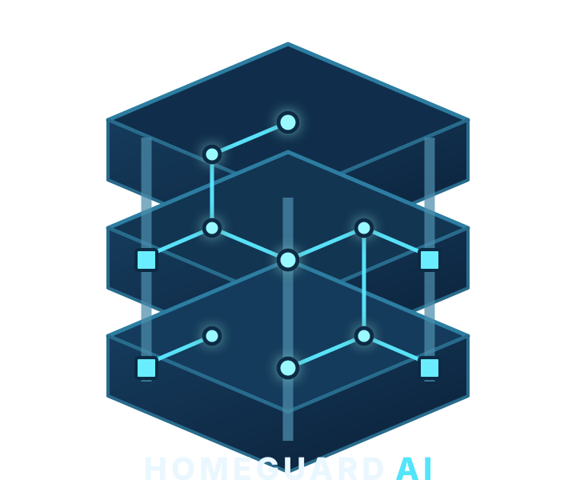
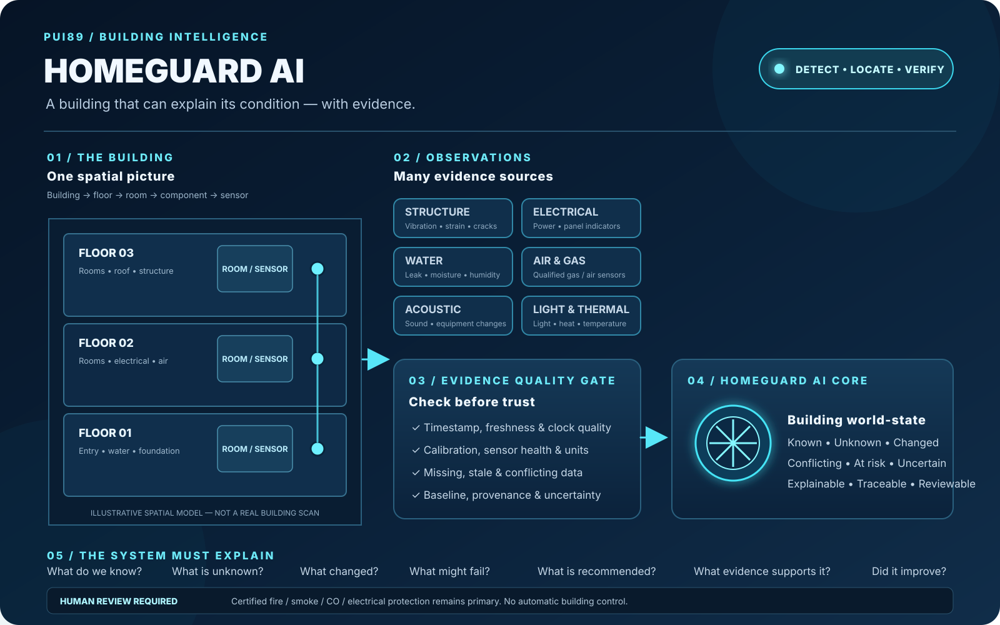
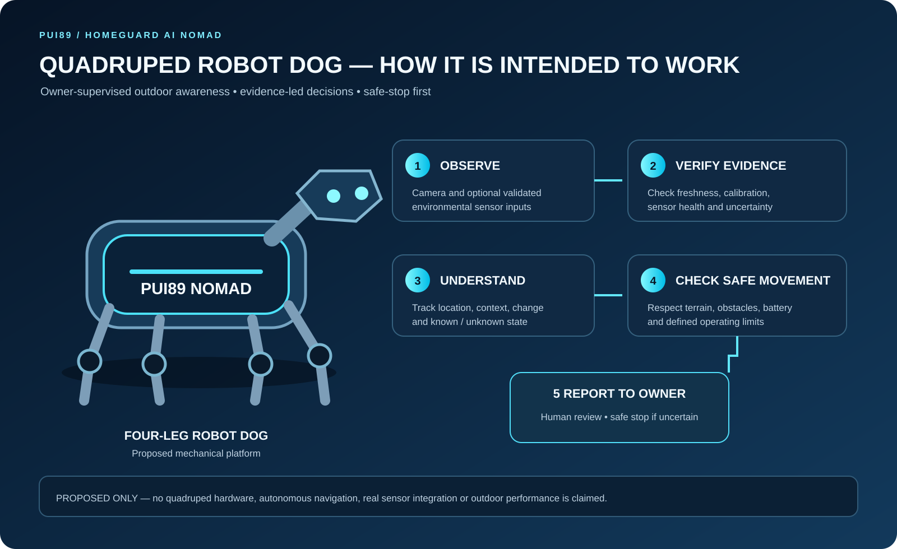
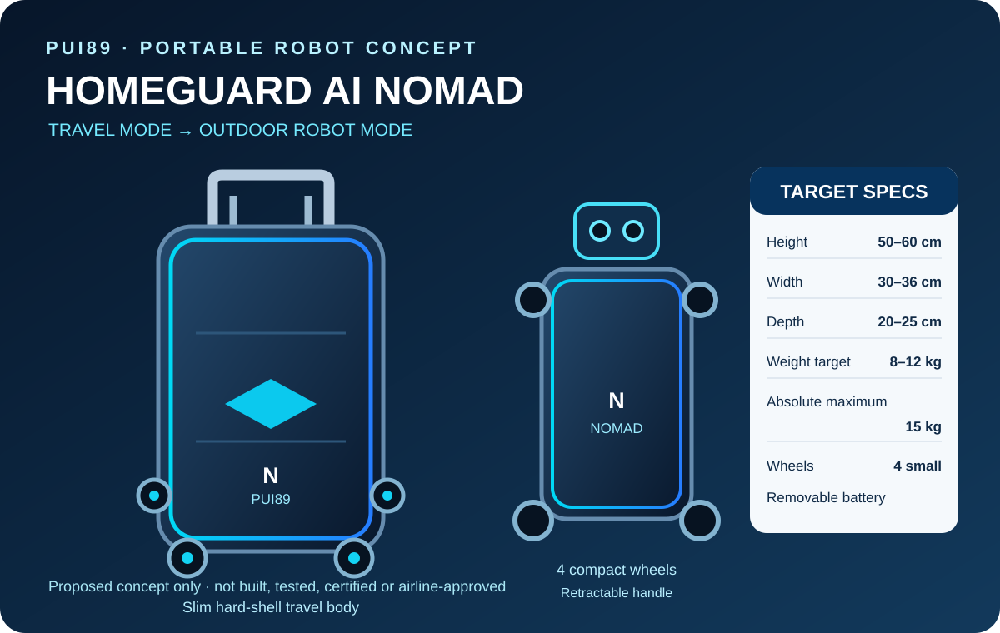

# HOMEGUARD AI NOMAD
### Portable Outdoor Intelligent Guardian

**Your Intelligent Guardian. Wherever You Go.**

> **Product identity:** HOMEGUARD AI NOMAD is the proposed portable mobile-robot product within PUI89's HOMEGUARD AI concept. The repository name is `Homeguard-Ai-Nomad`.

**Detect Early. Locate Precisely. Protect Better.**

<p align="center"></p>



> **How it works:** Observe building conditions → locate each observation → verify evidence quality → understand the building's changing state → recommend human-reviewed action → measure whether the improvement worked.

HOMEGUARD AI is a software-first building-condition intelligence platform. It organizes observations from structural, electrical, fire/life-safety, water, environmental, acoustic, light and thermal sources; compares them with documented baselines; exposes uncertainty; and helps people prioritize verification.

> **Current status: FOUNDATION / SIMULATION-ONLY.** This is an initial deterministic software demonstrator, not a deployed building-monitoring product. No real sensor integration, trained AI model, certified alarm, structural certification or real-world hazard-detection performance is claimed.

## Initial implementation
- Typed, provenance-aware sensor observations and baselines
- Quality checks for stale, missing, invalid and uncalibrated evidence
- Transparent baseline-deviation detection
- Deterministic synthetic three-floor scenario
- Machine-readable JSON findings
- Automated tests and GitHub Actions CI

The 29-capability catalogue is a roadmap, not 29 implemented models. No trained model is required for the first demonstrator.

## HOMEGUARD AI robot family — two purpose-built designs (PROPOSED)

HOMEGUARD AI should use **two separate robot types** rather than forcing one physical platform to perform equally well indoors and outdoors. They share the PUI89 AI Core, evidence model, reporting approach and safety principles, but have different mechanical designs, sensors, navigation and environmental protection.

| Product | Intended environment | Design priority |
|---|---|---|
| **HOMEGUARD AI HOME** | Indoor homes and buildings | Compact, quiet movement; safe navigation around people, furniture and pets; indoor mapping; return to a charging dock |
| **HOMEGUARD AI NOMAD** | Outdoor travel and camping | Suitcase-sized portable platform; four compact wheels; retractable handle; removable battery; supervised outdoor monitoring |

### HOMEGUARD AI HOME — indoor robot concept (PROPOSED)

HOME is a dedicated indoor mobile-robot concept. Its priorities are a compact footprint, low-noise movement, careful navigation through doors and corridors, obstacle and drop-off awareness, privacy-conscious sensing, and reliable docking. Its final dimensions, wheel arrangement, sensor package, battery and charging design remain open engineering decisions; no unverified hardware specification is claimed.

### HOMEGUARD AI NOMAD — outdoor robot concept (PROPOSED)

NOMAD is the separate outdoor platform for owner-supervised travel and camping. Its proposed form is suitcase-sized and slim, with four compact wheels, a retractable travel handle and a removable battery. It is not intended to be the indoor home-patrol robot.

### Shared intelligence, separate physical platforms

Both products are intended to share PUI89 AI Core capabilities: observe, verify evidence quality, understand context, assess uncertainty and risk, choose a safe response, and explain the result to the owner. Indoor and outdoor navigation, sensor configuration, mechanical design and environmental limits must remain product-specific.

### How HOMEGUARD AI NOMAD is intended to work



**Proposed workflow:** observe → check evidence quality → understand location and context → choose a safe movement state → report to the owner. The owner reviews alerts and decides what action to take. The robot should return only when its location, route and battery reserve are safe; otherwise it should stop safely.

This is an explanatory concept, not an implemented autonomous system. Sensor inputs, navigation, return-to-owner and safe-stop behaviour require separate engineering and testing.

<p align="center"></p>

*Latest NOMAD robot concept illustration — proposed design, not a built or validated robot.*

<em>Physical design target — concept only, not a built or measured specification.</em>

| Design parameter | Proposed target |
|---|---:|
| Height | 50–60 cm |
| Width | 30–36 cm |
| Depth | 20–25 cm |
| Complete weight target | 8–10 kg, including battery, sensors and computer |
| Absolute maximum complete weight | 12 kg |
| Wheels | Four small, compact wheels; no oversized off-road tyres |
| Handle | Retractable travel handle |
| Battery | Removable; airline carriage subject to carrier rules |
| Structure | Lightweight hard shell |

The design priority is a slim, hard-shell travel case that one person can carry and transport. The 8–10 kg target and 12 kg absolute maximum include the battery, sensors and computer. These are engineering goals, not measured specifications; final dimensions depend on battery capacity, sensor selection, stability, weather protection and safety testing.

A future NOMAD robot may extend the software platform with these outdoor missions:

1. **Outdoor awareness:** monitor an owner-approved travel or campsite area, identify potentially relevant activity and report evidence for human review. Indoor patrol belongs to the separate HOME product.
2. **Detect hazards:** collect and assess fire-related and explosion-related warning signals, such as smoke, abnormal heat, acoustic events or pressure changes, where suitable sensors are installed and validated. The robot is an awareness and reporting system; it is not a firefighting robot, does not handle explosive materials and does not cause or trigger explosions.
3. **Explore:** build and update maps, navigate around people and obstacles, inspect assigned areas and return to a charging dock when conditions permit.
4. **Travel and camping:** accompany its owner on trips and monitor an approved campsite while the owner rests, reporting possible movement, wildlife, smoke or environmental changes for human review. This is awareness support, not wildlife deterrence or guaranteed protection.

### NOMAD outdoor operating profiles (PROPOSED)

- **Travel mode:** owner-supervised outdoor movement in a defined operating area, with GPS outdoors and local navigation where GPS is unavailable or unsuitable.
- **Camping night mode:** quiet monitoring with reduced lighting and non-essential sound; alert the owner when a potentially relevant event is detected.

HOME has its own indoor operating profile and charging-dock concept; it is a separate robot design, not another mode of NOMAD.
- **Outdoor hardware goals:** weather-resistant enclosure; compact wheels; low-light camera and suitable thermal sensor; 360° obstacle detection; portable charging; offline-first local operation.
- **Safe return / safe stop:** return to its owner only when localization, route safety and battery reserve are sufficient. If safe return cannot be established, stop safely and alert the owner when communication is available.
- **Operating limits:** define and test limits for rain, dust, temperature, slopes, loose ground, water exposure, darkness, battery endurance and connectivity. Do not send the robot roaming into unknown wilderness without supervision.

### Robot safety and protective engineering

Safety is a design requirement, not a capability that can be claimed without testing.

- **Do not become an ignition source:** prioritize battery safety, thermal-runaway mitigation, electrical isolation, overcurrent protection, protected wiring and suitable component selection.
- **Fire resistance:** select enclosure and insulation materials for defined temperature and flame-exposure requirements, then verify them through appropriate independent testing. “Fire-resistant” does not mean fireproof.
- **Explosion protection:** distinguish preventing the robot from igniting a hazardous atmosphere from surviving an external blast. These are different engineering problems. Operation in a classified explosive atmosphere requires a design assessed and certified for the specific zone, gas/dust group and temperature class. No general blast-survival or explosion-proof claim is made.
- **Emergency behaviour:** on a suspected hazard, warn the responsible people, preserve available evidence and stop or retreat only when the route and robot state are assessed as safe. Never send the robot into a dangerous area merely to investigate.
- **Human safety first:** certified building alarms, emergency procedures and qualified responders remain authoritative. The robot must not delay evacuation or emergency response.

The HOMEGUARD AI NOMAD robot, its suitcase-sized dimensions, 8–10 kg target and 12 kg absolute maximum, outdoor mode and wildlife-awareness functions are **future proposals only**. They have not been built, integrated, certified or validated. Sensor performance, navigation, weather resistance, animal detection, battery protection, fire performance and any explosion-protection rating require separate requirements, engineering reviews and test evidence before deployment.

## Quick start
Requires Python 3.11+.
```bash
python -m pip install -e ".[dev]"
pytest
homeguard-simulate --seed 89 --output report.json
```

## Safety and privacy
Decision support only. The current software demonstrator does not operate breakers, valves, lifts, doors or alarms; certify a building; or replace qualified professionals. Certified smoke, fire, CO and electrical protection devices remain primary. Never wait for AI analysis before following a certified alarm or established emergency procedure. Minimize personal data; prefer acoustic features over recording conversations; avoid unnecessary indoor video, face recognition and profiling.

## Procurement policy
The initial foundation has no remote inference, model download, paid API, subscription or cloud-GPU dependency. This project excludes Chinese-origin AI models, providers and model-hosting services from its approved stack. Future dependencies require provenance, ownership, licence, security, privacy, network, resource and cost review.

## Evidence labels
PROPOSED = planned; IMPLEMENTED = code exists; TESTED = automated test passed; SIMULATION-ONLY = synthetic inputs only; MEASURED = quantitative result with method; VERIFIED = reproducibly checked; NOT_VALIDATED = real-world performance not established.

See [Architecture](docs/ARCHITECTURE.md), [Safety Case](docs/SAFETY_CASE.md), [Intelligence Catalogue](docs/INTELLIGENCE_CATALOGUE.md), [Supply-chain Policy](docs/MODEL_AND_SUPPLY_CHAIN_POLICY.md) and [Roadmap](docs/ROADMAP.md).

**PUI89 — Intelligent Systems. Verifiable Decisions. Safer Outcomes.**

## Commercial product readiness

This project follows the [PUI89 Commercial Product & Company-Readiness Standard](PUI89_COMMERCIAL_PRODUCT_STANDARD.md). Commercial use of original materials is governed by the root [LICENSE](LICENSE); third-party assets retain their own terms. Sale-readiness and safety claims require evidence.
