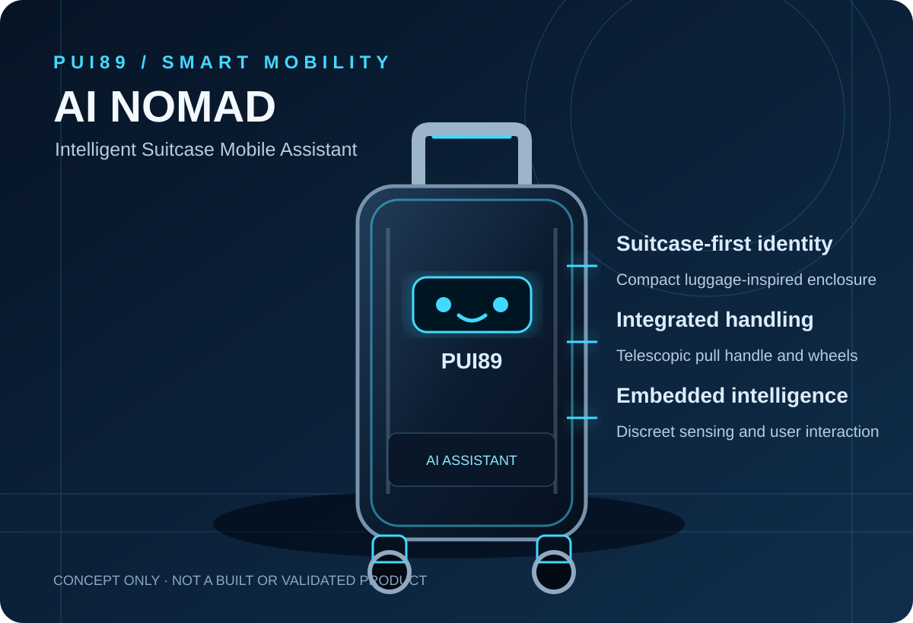

# PUI89 AI NOMAD — Intelligent Suitcase Mobile Assistant

[English](README.md) · [ภาษาไทย](README.th.md)

**A compact AI-enabled mobile assistant designed around a suitcase form.**

[English project page](https://pui89.github.io/nomad.html) · [ภาษาไทย](https://pui89.github.io/nomad-th.html) · [PUI89 portfolio](https://pui89.github.io/)

*Concept illustration only. It is not evidence of a built, integrated, tested or validated product.*

## Product identity

PUI89 AI NOMAD is a **suitcase-form intelligent mobile assistant**. Its defining physical language is a compact luggage-inspired body, an integrated telescopic pull handle and integrated wheels, combined with discreet AI sensing and interaction features.

NOMAD is a smart suitcase/mobile-assistant concept. Its suitcase form is the defining physical identity.

## Intended role

NOMAD is intended to explore helpful, user-directed assistance around personal travel and everyday mobility. Candidate functions may include:
- Context-aware user assistance and information.
- Obstacle and surrounding-environment awareness.
- Status, safety and battery-related notifications where supported by verified hardware.
- Local-first interaction and privacy-conscious data handling.
- Optional connectivity features that do not replace essential local controls.

These are proposed product directions, not verified or implemented capabilities.

## Physical design direction

| Element | Design direction | Evidence status |
|---|---|---|
| Form | Compact smart suitcase / luggage-inspired enclosure | Design direction |
| Handling | Integrated telescopic pull handle | Design direction |
| Mobility | Integrated luggage-style wheels | Design direction |
| Intelligence | Discreet embedded sensing and user interaction | Concept |
| Total mass | Preliminary target 8–10 kg; 10 kg maximum | Target only; not measured |
| Dimensions, payload and wheel layout | To be defined through product and user research | Not established |

The 10 kg figure is a preliminary complete-product design ceiling, not a measured prototype result or a claim of airline cabin-baggage compliance. Dimensions and airline acceptance must be checked against the applicable carrier rules if travel use is pursued.

## Safety, privacy and evidence

- Keep essential handling, power and stop functions available without an app or internet connection.
- Use human-reviewed assistance and clearly communicate uncertainty and sensor limitations.
- Do not claim autonomous travel, obstacle avoidance, follow-me operation, weather resistance, airline approval or any physical performance without repeatable evidence.
- Distinguish design proposals, implemented software, test results and validated physical capabilities.

## Development status

**Concept and early software foundations.** No completed physical product, integrated sensor suite, validated mobility performance or certification is claimed.

**Next evidence gate:** confirm the primary user journey, suitcase dimensions, handling ergonomics, wheel/rolling requirements, complete mass budget, sensor placement, power budget and measurable acceptance criteria before hardware selection.

## Shared PUI89 engineering

NOMAD may reuse versioned interfaces and evidence practices from the [PUI89 Shared AI Core](https://github.com/Pui89/PUI89-Shared-AI-Core). Its suitcase enclosure, handling, rolling mechanics, power, sensors, privacy and product safety require NOMAD-specific engineering and validation.

## Latest engineering progress — 22 November 2026

**Maturity:** Implemented — early software foundation. **Evidence status:** PARTIAL. The product remains a suitcase-form AI mobile-assistant concept; this status does not imply a built or integrated suitcase robot.

**Recent verified repository progress:**
- Merged the NOMAD identity correction to the suitcase form and removed obsolete non-suitcase/rover concept references (PR #121).
- The current README identifies the telescopic pull handle and luggage-style wheel direction; the 8–10 kg target and 10 kg maximum remain design targets, not measured prototype values.

**Not established:** a physical prototype, integrated sensor suite, validated rolling/mobility performance, environmental protection, battery endurance, airline/cabin-baggage acceptance or field reliability.

**Next evidence gate:** validate the primary user journey and ergonomic requirements; baseline external dimensions, handle geometry, wheel arrangement, complete mass budget, sensor placement, power budget, privacy controls and measurable acceptance criteria before selecting hardware.

**Last reviewed:** 22 November 2026. See [NOMAD suitcase-identity correction PR #121](https://github.com/Pui89/AI-Mobile-Assistant-Robot/pull/121).

## Global manufacturing engineering

The product-specific [PUI89 Global Manufacturing Design Brief v1.0](docs/PUI89_GLOBAL_MANUFACTURING_DESIGN_BRIEF_V1.0.md) defines the preliminary product envelope, candidate material families, component architecture, global human-factors requirements, extreme-environment design strategy, manufacturing transfer package, quality gates and unresolved specifications. It distinguishes proposed targets from tested or verified performance. Candidate materials and component types are not an approved BOM; exact grades, models, dimensions and tolerances remain open until engineering analysis and validation.
