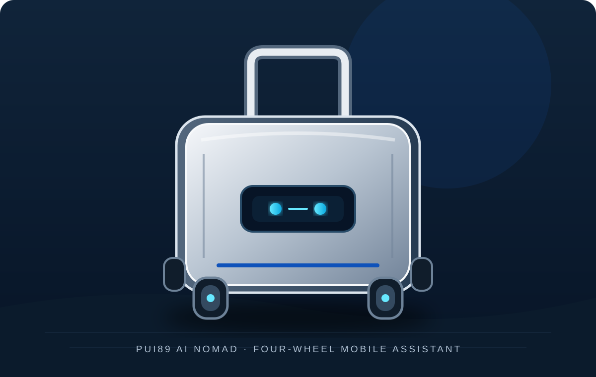

# PUI89 AI NOMAD — ผู้ช่วยเคลื่อนที่ 4 ล้อ

[English](README.md) · [ภาษาไทย](README.th.md)

**แนวคิดผู้ช่วยเคลื่อนที่ 4 ล้อขนาดกะทัดรัด รูปทรงได้แรงบันดาลใจจากสุนัข พร้อมด้ามจับในตัว**

[เว็บไซต์ภาษาอังกฤษ](https://pui89.github.io/nomad.html) · [เว็บไซต์ภาษาไทย](https://pui89.github.io/nomad-th.html) · [PUI89 Portfolio](https://pui89.github.io/)

*ภาพแนวคิดเท่านั้น ไม่ใช่หลักฐานว่ามีผลิตภัณฑ์จริง ติดตั้งระบบ ทดสอบ หรือผ่านการตรวจสอบแล้ว*

## อัตลักษณ์ผลิตภัณฑ์

PUI89 AI NOMAD คือ **ผู้ช่วยเคลื่อนที่ 4 ล้อขนาดกะทัดรัด รูปทรงได้แรงบันดาลใจจากสุนัข พร้อมด้ามจับในตัว** แตกต่างจากหุ่นยนต์ AI HOME โดยด้ามจับใช้สำหรับการเคลื่อนย้ายที่ผู้ใช้ควบคุม ไม่ได้หมายถึงการติดตามผู้ใช้หรือการทำงานอัตโนมัติโดยไม่มีผู้ดูแล

NOMAD ยังเป็นแนวคิดผลิตภัณฑ์ ไม่ใช่ผลิตภัณฑ์ที่สร้างและตรวจสอบแล้ว

## วิศวกรรมและการผลิตระดับสากล

ดู [PUI89 Global Engineering & Manufacturing Design Brief](docs/PUI89_GLOBAL_MANUFACTURING_DESIGN_BRIEF_V1.0.md) สำหรับข้อกำหนดเบื้องต้นด้านขนาด วัสดุประเภทที่อยู่ระหว่างศึกษา กลุ่มส่วนประกอบ การผลิตหลายประเทศ การทดสอบสภาพแวดล้อม และเกณฑ์การตรวจสอบ เอกสารนี้แยกเป้าหมายการออกแบบออกจากผลทดสอบจริง รายการวัสดุและส่วนประกอบยังไม่ใช่ BOM ที่อนุมัติผลิต ขนาด เกรดวัสดุ รุ่นชิ้นส่วน และค่าความคลาดเคลื่อนที่ยังไม่มีหลักฐานจะระบุเป็น TBD จนกว่าจะผ่านการวิเคราะห์และการตรวจสอบทางวิศวกรรม

## ระบบวิศวกรรมและการผลิตระดับสากล

สำหรับวิศวกร โรงงาน และผู้ปฏิบัติงานในทุกประเทศ ให้ใช้งานเอกสารควบคุมกลางของ PUI89:
- [พอร์ทัลวิศวกรรมและการผลิต PUI89](https://pui89.github.io/global-engineering.html)
- [PUI89 Global Manufacturing Handoff System v1.0](https://github.com/Pui89/Pui89.github.io/blob/main/docs/PUI89_GLOBAL_MANUFACTURING_HANDOFF_SYSTEM_V1.0.md)

**กฎการผลิต:** ซื้อ ผลิต เปลี่ยนชิ้นส่วน ตรวจสอบ หรืออนุมัติผลิตภัณฑ์ได้เฉพาะตาม configuration, revision, drawing, BOM และ work instruction ที่อนุมัติแล้วเท่านั้น หากข้อมูลขาดหายหรือขัดแย้ง ให้ **หยุดงาน — ห้ามเดา** และเปิด Technical Query (TQ) ชุดแบบฟอร์มการผลิตกลางกำลังตรวจสอบใน [PUI89 website PR #639](https://github.com/Pui89/Pui89.github.io/pull/639) และยังไม่ใช่เอกสารอนุญาตให้ผลิต

## นโยบายเทคโนโลยีพร้อมรับอนาคต

ผลิตภัณฑ์นี้ยึดแนวทางตาม [นโยบายเทคโนโลยีพร้อมรับอนาคตของ PUI89 v1.0](https://github.com/Pui89/PUI89-Shared-AI-Core/blob/main/docs/architecture/PUI89_FUTURE_READY_TECHNOLOGY_POLICY_V1.0.th.md) ซึ่งกำหนดให้ออกแบบอินเทอร์เฟซที่อัปเกรดได้ เลือกเทคโนโลยีจากหลักฐาน ตรวจสอบแหล่งที่มา/ใบอนุญาต ควบคุมทรัพยากรแบบ Local-first ทดสอบความเข้ากันได้ มีระบบสำรองที่ปลอดภัย และควบคุมขอบเขตการส่งมอบ โดยติดตามเทคโนโลยีทุกเดือนและทบทวนสถาปัตยกรรมทุกไตรมาส การเพิ่มลิงก์นี้เป็นการอ้างอิงนโยบาย ไม่ได้ยืนยันว่ามีการสลับโมเดล Hardware Abstraction, Sensor Adapter ระบบติดตามอัตโนมัติ หรือการตรวจสอบผลิตภัณฑ์แล้ว

## แผนอัปเกรดเทคโนโลยีเฉพาะผลิตภัณฑ์

**ความสอดคล้องกับ Gartner 2026:** Physical AI, Domain-Specific Models, Hybrid Compute และ Digital Provenance ดู [นโยบายกลางของ PUI89](https://github.com/Pui89/PUI89-Shared-AI-Core/blob/main/docs/architecture/PUI89_FUTURE_READY_TECHNOLOGY_POLICY_V1.0.th.md)

| ด้านที่อัปเกรด | ลำดับแผน (ยังไม่ใช่การยืนยันความสามารถ) |
|---|---|
| Context-aware Assistance | กำหนดบริบทที่รองรับและระบบสำรองแบบระมัดระวัง ใช้ความรู้เฉพาะงานที่ตรวจสอบที่มาได้ ไม่ใช้ Agent ทั่วไปที่ทำงานไร้ขอบเขต |
| Vision และ Edge Intelligence | วัด Perception/Inference พลังงานต่ำ ทั้ง Latency, Memory, Energy และ Thermal บนฮาร์ดแวร์เป้าหมาย |
| Navigation และ Localisation | กำหนดขอบเขตใช้งานใน/นอกอาคาร ข้อมูล Localisation และการตอบสนองเมื่อระบุตำแหน่งไม่ได้ ทดสอบในสภาพแวดล้อมควบคุม |
| Offline Resilience | ระบุฟังก์ชันที่ยังทำงานได้เมื่อไม่มีเครือข่าย และวิธีแจ้งบริบทที่ล้าสมัยหรือไม่แน่นอน |

**Gate แรก:** ยืนยันกรณีใช้งานหลัก รูปทรงและมิติ การจับถือ การจัดวางล้อ 4 ล้อ เสถียรภาพ ขอบเขตการใช้งานภายใต้การดูแล งบประมาณน้ำหนักและพลังงาน ตำแหน่งเซนเซอร์ และเกณฑ์ยอมรับที่วัดผลได้ก่อนเลือกฮาร์ดแวร์ **สถานะ:** แผนที่เสนอเท่านั้น

## แผนวิวัฒนาการเทคโนโลยีระยะยาวและการป้องกันความล้าสมัย (2027–2030+)

แผนระยะยาวนี้ต่อยอดจากลำดับพัฒนา P1–P4 และขยายกรอบคิดจากแนวโน้มปี 2026 ไปข้างหน้า โดยเป็นช่วงเวลาสำหรับประเมิน ไม่ใช่การรับประกันความสามารถหรือกำหนดวันนำมาใช้ เทคโนโลยีทุกชนิดต้องผ่านการพิสูจน์คุณค่าต่อผู้ใช้ ที่มาและใบอนุญาต ความเหมาะสมกับฮาร์ดแวร์ ความปลอดภัย การบำรุงรักษา และหลักฐานที่ทำซ้ำได้

| ช่วงเวลา | แนวทางวิวัฒนาการของผลิตภัณฑ์ |
|---|---|
| 2027 | ยืนยันแนวคิดการเคลื่อนที่ ขอบเขตการใช้งาน งบ Compute พลังงานต่ำ ฟังก์ชัน Offline และการ Human Override ที่ปลอดภัย |
| 2028 | ประเมิน Vision/Context Model ที่มีประสิทธิภาพ การระบุตำแหน่ง และระบบช่วยนำทาง พร้อมวัดผลกระทบต่อแบตเตอรี่ ความร้อน Latency และการเชื่อมต่อ |
| 2029 | สำรวจ Context Continuity, การรับรู้เส้นทาง/สิ่งกีดขวางที่ปรับตามบริบท และ Personalisation ที่รักษาความเป็นส่วนตัวพร้อมการควบคุมโดยผู้ใช้ |
| 2030+ | ออกแบบให้ Compute, Battery Management, Sensor และ AI Module เปลี่ยนได้ รักษาความสามารถ Offline ที่จำเป็น และไม่พึ่ง Cloud ตลอดเวลา |

**กฎป้องกันความล้าสมัยอย่างต่อเนื่อง:** ติดตามสัญญาณเทคโนโลยีทุกเดือน ทบทวนสถาปัตยกรรมทุกไตรมาส และทบทวน Roadmap ทั้งหมดทุกปี พร้อมทบทวนนอกกำหนดเมื่อ Dependency สำคัญหยุดสนับสนุน พบปัญหาความปลอดภัย หรือผลทดสอบเกินข้อจำกัดด้านประสิทธิภาพ/ทรัพยากร ทุกการอัปเกรดต้องมี Baseline ที่ตรวจสอบแล้ว แผน Migration/Rollback ชุดทดสอบ Compatibility/Regression และบันทึกเหตุผลการตัดสินใจ ห้ามเลือกเทคโนโลยีเพียงเพราะเป็นของใหม่ **สถานะ:** เป็นแผนที่เสนอ ยังไม่กล่าวอ้างว่าความสามารถในอนาคตถูกพัฒนาหรือ Validate แล้ว

---

## ทิศทางการวิจัยทางวิชาการ — เป้าหมายวารสาร Q1 (ข้อเสนอ)

**หัวข้อวิจัย:** Adaptive Edge AI สำหรับหุ่นยนต์ผู้ช่วยเคลื่อนที่  
**ชื่อบทความเบื้องต้น:** *Resource-Adaptive Hybrid Edge Intelligence for Reliable Perception and Navigation in Compact Outdoor Mobile Assistants*

**สถานะ:** ข้อเสนอเพื่อให้อาจารย์พิจารณา ความใหม่ ชุดข้อมูล ฮาร์ดแวร์ และการทดสอบจริงยังไม่ผ่านการยืนยัน

### ปัญหาและช่องว่าง
หุ่นยนต์ผู้ช่วยขนาดเล็กมีข้อจำกัดด้าน Compute, Memory, Battery และความร้อน โมเดลใหญ่ใช้ทรัพยากรมาก ส่วนโมเดลเล็กอาจไม่เข้าใจสถานการณ์ใหม่ ต้องศึกษาการปรับ Inference ตามความซับซ้อนของฉาก คุณภาพ Sensor และทรัพยากรที่เหลืออยู่ ช่องว่างที่ต้องตรวจสอบ ได้แก่ การเลือกโมเดลแบบคงที่ การขาดการวัด Latency/RAM/Energy/Thermal และความต่อเนื่องของผลเมื่อสลับโมเดล

### คำถามและสมมติฐาน
- RQ1 การเลือกโมเดล Specialist ขนาดเล็กและ Semantic Model ตามสถานการณ์ให้ Trade-off ดีกว่าโมเดลคงที่หรือไม่
- RQ2 ควรใช้ Scene Complexity, Uncertainty และ Compute Headroom กำหนดโมเดลและความถี่ Inference อย่างไร
- RQ3 Degraded Mode และ Safe Stop ช่วยเมื่อ Compute เกินกำลัง Sensor ขาด หรือโมเดลผิดพลาดหรือไม่
- H1 Adaptive Inference จะปรับปรุง Accuracy/Latency หรือ Accuracy/Energy ภายใต้งบที่กำหนด
- H2 Reliability Gate จะลดผลลัพธ์นำทางที่ไม่มีหลักฐานรองรับเมื่อระบบเสื่อมลง

### วิธีการแบบ Hybrid AI
ใช้ Detector/Segmenter ขนาดเล็กสำหรับงานต่อเนื่อง ประเมินความซับซ้อน ความกำกวม คุณภาพ Sensor และ Compute Headroom ก่อนเรียก Vision/Foundation Model ขนาดใหญ่ขึ้น ทดลอง Quantization/Distillation เมื่อวัดผลได้จริง คง Geometry, Localization, Mapping และ Obstacle Check แบบดั้งเดิม ใช้ Scheduler ปรับโมเดล Resolution และความถี่ Inference เมื่อเกินกำลังหรือหลักฐานไม่พอ ให้ลดระดับ ขอมนุษย์ช่วย หรือหยุด

### ชุดข้อมูล
พิจารณา RELLIS-3D, TartanAir และ OpenLORIS-Scene หลังตรวจสอบใบอนุญาตและความเหมาะสม ต้องมีข้อมูลเส้นทางภายนอกที่ได้รับอนุญาต พร้อม RGB/Depth, IMU/Odometry เท่าที่มี Route/Session, แสง อากาศ พื้นผิว และป้ายกำกับสิ่งกีดขวาง บันทึก CPU/GPU/NPU, RAM, วิธีวัด Energy และ Thermal แยกผล Simulation, Desktop และ Embedded Device

### การทดลองและตัวชี้วัด
เปรียบเทียบ Always-small, Always-large, Fixed Cascade, Adaptive Scheduler และ Navigation Baseline ทดสอบความซับซ้อน/กำกวม แสงน้อย แสงสะท้อน สิ่งกีดขวางเคลื่อนที่ เส้นทางใหม่ Sensor Dropout และ Compute Saturation วัด Latency, Throughput, RAM, Model Size, Energy, Thermal และผลภายใต้งบ Compute/Energy ที่เท่ากัน

**ผลหลัก:** Task Success ภายใต้งบ Energy/Latency หรือ Accuracy ภายใต้งบ Compute ที่กำหนดล่วงหน้า  
**ผลรอง:** F1, Path Completion, Intervention/Stuck Rate, Safe-stop, Latency, RAM, Energy และ Model-switch Overhead

### ผลงานที่คาดหวังและขอบเขต
นโยบาย Adaptive Inference ที่ทำซ้ำได้สำหรับหุ่นยนต์ผู้ช่วยเคลื่อนที่ แสดงเงื่อนไขที่โมเดลเล็กเพียงพอและเงื่อนไขที่ควรใช้ Semantic Model

AI NOMAD เป็นผู้ช่วยเคลื่อนที่ 4 ล้อรูปแบบได้แรงบันดาลใจจากสุนัข มีด้ามจับในตัว เป้าหมายน้ำหนัก 8–10 กก. และขีดจำกัดออกแบบ 10 กก. ซึ่งยังไม่ Validate และแตกต่างจาก AI HOME ต้องตรวจสอบที่มา ใบอนุญาต และแหล่งกำเนิดโมเดล/ข้อมูล ห้ามกล่าวอ้างความสามารถภาคสนามหรือ Runtime หากไม่มีผลวัดจริง

## 360° Intelligence

กำหนดการรับรู้สิ่งแวดล้อมรอบ AI NOMAD สำหรับการใช้งานแบบมีผู้ใช้กำกับ โดยคำนึงถึงด้ามจับ ล้อ ผู้ใช้ สิ่งบรรทุก และจุดบอดระยะใกล้ ดู [360° Intelligence Profile v1.0](docs/PUI89_360_DEGREE_INTELLIGENCE_PROFILE_V1.0.md) และ [สถาปัตยกรรมกลาง](https://github.com/Pui89/PUI89-Shared-AI-Core/blob/main/docs/PUI89_360_DEGREE_INTELLIGENCE_V1.0.md) **สถานะ: Proposed** ยังไม่มีต้นแบบจริงหรือระบบเซนเซอร์ 360° ที่ผ่านการทดสอบ
