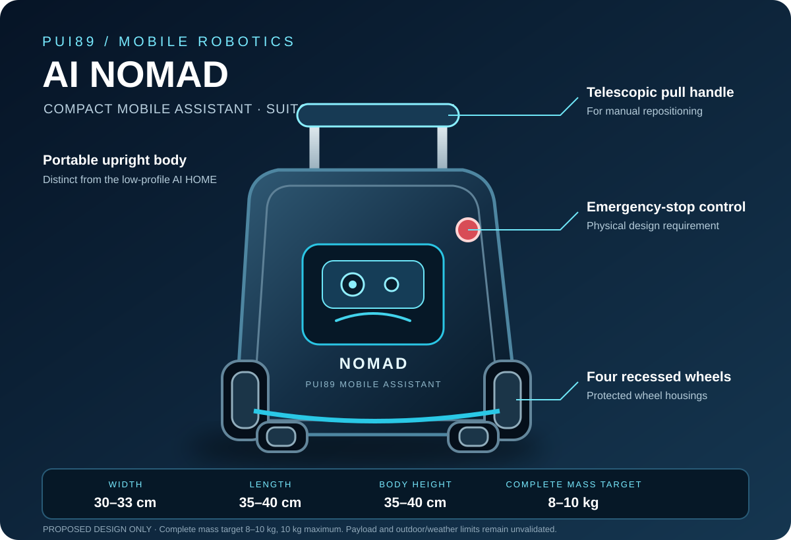

# PUI89 AI NOMAD — หุ่นยนต์ผู้ช่วยเคลื่อนที่ภาคพื้นดินแบบ 4 ล้อ

**แนวคิดหุ่นยนต์ผู้ช่วยเคลื่อนที่ขนาดกะทัดรัด รูปทรงได้แรงบันดาลใจจากสุนัข มีล้อ 4 ล้อและด้ามจับสำหรับเคลื่อนย้ายด้วยมือ**

[English](README.md) · [ภาษาไทย](README.th.md) · [เว็บไซต์ภาษาอังกฤษ](https://pui89.github.io/nomad.html) · [เว็บไซต์ภาษาไทย](https://pui89.github.io/nomad-th.html) · [PUI89 Portfolio](https://pui89.github.io/)

*ภาพแนวคิดเท่านั้น ไม่ใช่หลักฐานว่ามีหุ่นยนต์จริง ติดตั้งระบบ ทดสอบ หรือผ่านการตรวจสอบแล้ว*

## 1. ผลิตภัณฑ์นี้คืออะไร

PUI89 AI NOMAD เป็นหุ่นยนต์ผู้ช่วยเคลื่อนที่ภาคพื้นดินแบบ **4 ล้อ** ขนาดกะทัดรัด รูปทรงได้แรงบันดาลใจจากสุนัข และมีด้ามจับแบบหดเก็บได้สำหรับให้คนจับเพื่อเคลื่อนย้ายหรือจัดตำแหน่งด้วยมือ เป็นหุ่นยนต์ล้อ ไม่ใช่หุ่นยนต์สี่ขาแบบมีข้อต่อ และไม่ใช่กระเป๋าเดินทางหรือสัมภาระขึ้นเครื่องบิน

## 2. ภารกิจและขอบเขตหน้าที่

สนับสนุนงานช่วยเหลือและการเคลื่อนที่ภายใต้การกำกับของมนุษย์ในสภาพแวดล้อมภาคพื้นดินที่เหมาะสม ขอบเขตการใช้งานจริงต้องกำหนดและตรวจสอบก่อนนำไปใช้ ด้ามจับมีไว้สำหรับการจัดการด้วยมือ ไม่ใช่สายจูง

## 3. ผู้ใช้งานและคุณค่าที่มุ่งส่งมอบ

ผู้ที่ต้องการหุ่นยนต์ผู้ช่วยเคลื่อนที่สำหรับงานที่กำหนด ช่วยรับรู้สภาพแวดล้อม ทางเดิน สิ่งกีดขวาง และให้ข้อมูลประกอบการทำงาน โดยผู้ใช้ยังคงกำกับการใช้งาน

## 4. ความสามารถเฉพาะผลิตภัณฑ์

- รับรู้สภาพแวดล้อมและฉากในพื้นที่ปฏิบัติงานที่กำหนด
- สังเกตสิ่งกีดขวางและทางเดิน พร้อมระบุความไม่แน่นอนและเสนอให้หยุดอย่างปลอดภัย
- สนับสนุนงานและเส้นทางที่มนุษย์ตรวจสอบในสภาพแวดล้อมที่รองรับ
- แจ้งเตือนตามบริบทและโต้ตอบกับผู้ใช้ตามภารกิจ
- ตรวจสอบแบตเตอรี่ พลังงาน และอุณหภูมิเฉพาะเมื่อมีอินเทอร์เฟซที่ตรวจสอบแล้ว
- ใช้ด้ามจับสำหรับการเคลื่อนย้ายด้วยมือ การจัดเก็บสิ่งของเป็นหน้าที่รอง ไม่ใช่ภารกิจหลัก

## 5. AI และสถาปัตยกรรมความฉลาด

ความสามารถที่อาจใช้ ได้แก่ Object Detection, Image Segmentation, Object Tracking, SLAM, Sensor Fusion, Anomaly Detection และโมเดลพยากรณ์สำหรับสภาพระบบและพลังงาน ทั้งหมดเป็นแนวทางวิศวกรรมที่ต้องประเมิน ไม่ใช่หลักฐานว่ามีการติดตั้งหรือพิสูจน์การทำงานแล้ว และไม่ได้ให้อำนาจ AI ควบคุมตัวขับเคลื่อนโดยตรง

## 6. ฮาร์ดแวร์และเซนเซอร์

- รูปแบบการเคลื่อนที่: หุ่นยนต์ภาคพื้นดิน 4 ล้อ
- รูปทรง: ขนาดกะทัดรัด ได้แรงบันดาลใจจากสุนัข
- ด้ามจับ: สำหรับการจับและเคลื่อนย้ายด้วยมือ
- น้ำหนักรวมเป้าหมาย 8–10 กก. และ **น้ำหนักรวมสูงสุด 10 กก.** รวมแบตเตอรี่ ด้ามจับ สายไฟ และฮาร์ดแวร์ที่ติดตั้งทั้งหมด
- น้ำหนักบรรทุกและระบบขับเคลื่อนยังต้องกำหนดหลังวิเคราะห์ภารกิจและความปลอดภัย

## 7. ความปลอดภัย ความเป็นส่วนตัว และความมั่นคงปลอดภัย

ต้องมีขอบเขตการทำงานที่ชัดเจน การกำกับของมนุษย์ การจัดการเมื่อข้อมูลไม่เพียงพอ และการหยุดหรือขอความช่วยเหลือเมื่อมีความเสี่ยง ห้ามส่งข้อมูลภาพ เสียง ตำแหน่ง หรือข้อมูลผู้ใช้ไปยังบริการภายนอกที่ไม่ได้รับอนุญาต

## 8. สิ่งที่ยังไม่มีหลักฐานยืนยัน

- ยังไม่มีการยืนยันการเคลื่อนที่จริง การนำทาง การหลบสิ่งกีดขวาง ความทนทานกลางแจ้ง การทนสภาพอากาศ หรือความปลอดภัยภาคสนาม
- ยังไม่มีการอ้างความสามารถทำงานอัตโนมัติในพื้นที่สาธารณะโดยไม่มีผู้กำกับ การระบุตัวบุคคล การไล่ติดตาม การเผชิญหน้า หรือการบังคับใช้
- ไม่มีการอ้างว่าสามารถขึ้นบันได/บันไดเลื่อน ว่ายน้ำ หรือมีระดับการกันน้ำที่ผ่านการรับรอง
- ภาพแนวคิดหรือการทดสอบซอฟต์แวร์ไม่ใช่หลักฐานสมรรถนะทางกายภาพ

## 9. สถานะการพัฒนาและหลักฐาน

**Implemented — มีพื้นฐานซอฟต์แวร์ระยะแรก** หมายถึงงานซอฟต์แวร์เท่านั้น การเคลื่อนที่จริงและการบูรณาการหุ่นยนต์ยังไม่ได้รับการตรวจสอบ

## 10. ขั้นตอนพิสูจน์ผลถัดไป

กำหนดภารกิจผู้ใช้แรก สภาพแวดล้อม ขอบเขตการทำงาน น้ำหนักบรรทุก ข้อจำกัดการเคลื่อนที่ และเกณฑ์ยอมรับที่วัดผลได้ก่อนเลือกฮาร์ดแวร์

## 11. การเชื่อมต่อกับ Shared AI Core

ใช้สถาปัตยกรรมข้ามผลิตภัณฑ์ สัญญาหลักฐาน ความปลอดภัย ความเป็นส่วนตัว ความมั่นคงปลอดภัย การกู้คืน และการโต้ตอบจาก [PUI89 Shared AI Core](https://github.com/Pui89/PUI89-Shared-AI-Core) ส่วนข้อจำกัดการเคลื่อนที่ ด้ามจับ น้ำหนักบรรทุก และสภาพแวดล้อมต้องพิสูจน์แยกสำหรับ NOMAD

## 12. เอกสารและลิงก์โครงการ

- [แผนพัฒนา NOMAD](docs/ROADMAP.md)
- [ภาพแนวคิด NOMAD](docs/images/ai-nomad-compact-four-wheel.svg)
- [เว็บไซต์ภาษาอังกฤษ](https://pui89.github.io/nomad.html)
- [เว็บไซต์ภาษาไทย](https://pui89.github.io/nomad-th.html)

NOMAD แตกต่างจาก AI HOME ซึ่งเป็นหุ่นยนต์ผู้ช่วยภายในบ้าน และ Sentinel ซึ่งเป็นหุ่นยนต์สี่ขาสำหรับสำรวจและตรวจสอบ
