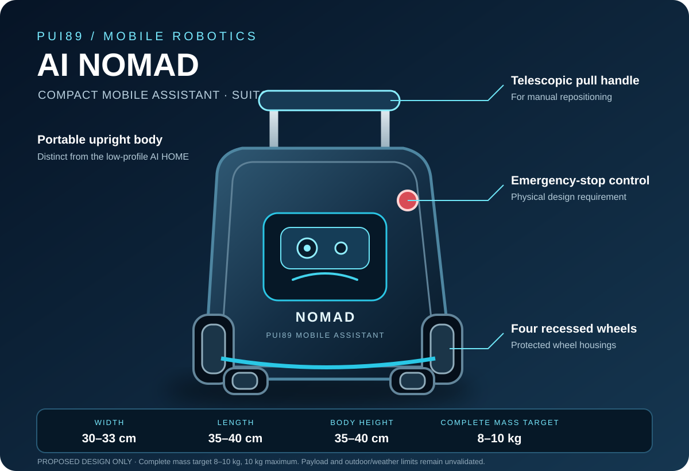

# PUI89 AI NOMAD — Product Concept Overview

PUI89 AI NOMAD is a suitcase-form AI mobile assistant designed around familiar travel luggage: a compact upright hard shell, four protected wheels, a telescopic manual pull handle, internal storage and a removable battery.

## Product promise

Bring local AI awareness and useful travel assistance into a practical luggage form. The first product must work as a normal manually handled suitcase before any powered mobility is considered.

## Two distinct modes

- **Travel Mode:** manual pull/push, drive disabled, battery and luggage status visible. Flight mode means powered down and compliant with the airline's battery and baggage rules.
- **Robot Mode:** a future supervised low-speed assistance mode for approved controlled areas outside aircraft and restricted airport zones. It requires independent motion safety, braking, emergency stop and manual override.

## Proposed capability areas

1. Luggage and trip status, checklist, local reminders and travel timeline.
2. Camera-based image quality and scene perception.
3. Object/obstacle detection, classification and short-term tracking.
4. Depth/spatial awareness when a calibrated depth sensor is available.
5. Indoor/outdoor location context where permitted positioning sources exist.
6. Battery, thermal, wheel/motor and device-health monitoring where sensors are integrated.
7. Owner-facing dashboard, event notifications and evidence history.
8. Future supervised mobile assistance, with safe stop and human override.

## What is not implied

The concept does not prove that a robot has been built, airline-approved, accepted as cabin baggage, integrated with sensors, trained on project-specific data or validated in a public environment. It is not a rideable suitcase, passenger carrier, autonomous airport vehicle or aircraft cabin robot. No face recognition or covert surveillance is intended.

See [Product Definition](PRODUCT_DEFINITION.md), [Air Travel & Battery Requirements](AIR_TRAVEL_AND_BATTERY_REQUIREMENTS.md) and [Safety Case](SAFETY_CASE.md).
