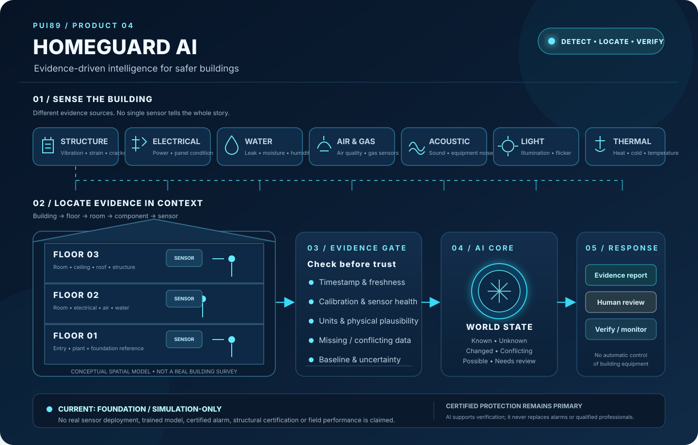

# HOMEGUARD AI — Concept Overview

HOMEGUARD AI is a software-first building-condition intelligence concept. It brings building observations into one traceable view, checks whether the evidence is trustworthy, compares it with documented baselines and helps a responsible person decide what should be verified.

## How to read the concept

1. **Sense:** structural, electrical, water, air/gas, acoustic, light and thermal sources provide different observations.
2. **Locate:** every usable observation should be connected to its building, floor, room, component and sensor.
3. **Check evidence:** the system checks timestamps, freshness, calibration, sensor health, units, missing values, conflicts and uncertainty before relying on a reading.
4. **Understand:** the AI Core maintains a world-state view of what is known, unknown, changed, conflicting or in need of review.
5. **Support people:** it creates an evidence report and a proposed verification priority for a responsible human.

## What the first version actually does

The current repository contains a deterministic software foundation, typed observations and baselines, evidence quality/freshness checks, a synthetic three-floor scenario, JSON findings and automated tests. The illustration describes the intended product architecture; it does not mean every sensor channel or AI capability is implemented.

## What it does not do

- It does not currently connect to real building sensors.
- It does not diagnose a building, certify structural safety or guarantee hazard detection.
- It does not replace certified fire, smoke, carbon-monoxide or electrical protection.
- It does not control breakers, valves, lifts, doors, alarms or evacuation systems.
- It does not infer a confirmed cause from one sensor or an uncertain pattern.

**Current evidence status: FOUNDATION / SIMULATION-ONLY.** Any future real-building pilot requires appropriately selected and calibrated sensors, qualified installation, privacy and security review, professional oversight and independent validation.
